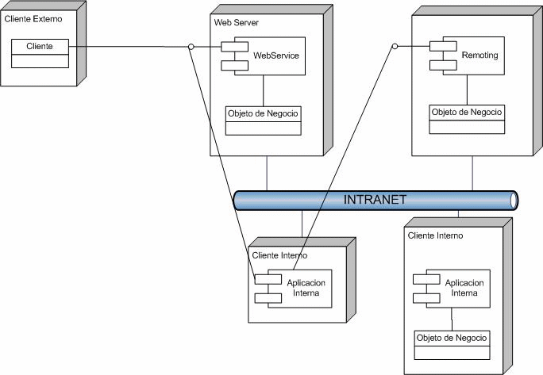

A while ago I published an article on web services and object remoting
at [Netveloper](http://www.netveloper.com/). You can read the
[article](http://www.netveloper.com/contenido.aspx?IDP=0&IDC=195) there,
but I have also decided to keep a copy on this blog.

Read on\...

**Conceptually, Web Services and Remoting are the same thing:
distributed objects. The main difference is the protocol.**

With Remoting you can use non-standard protocols. 
[Web Services](https://en.wikipedia.org/wiki/Web_service) 
use SOAP, or [RPC](https://en.wikipedia.org/wiki/Remote_procedure_call)-[XML](https://en.wikipedia.org/wiki/XML), open standards in general, over
[HTTP](http://en.wikipedia.org/wiki/Hypertext_Transfer_Protocol).

-   If you want to publish your services to the web, then you should use
    Web Services, because your clients may be running a different
    environment, such as [Java](https://java.sun.com), PHP, etc., and
    what matters is interoperability.

-   If it is for internal use, remoting can perform better if you use
    other protocols, ones that run over TCP and handle binary data
    instead of SOAP. You can do remoting with SOAP anyway, but then it
    is the same as web services, if you run it on IIS.

-   You can have remoting without installing anything on IIS. That can
    also help performance, but you have to take care of armoring it with
    all the other features IIS gives you, such as SSL, logging,
    security, etc. In the end, it is as if you had to build your own web
    server. That is why remoting is recommended for the intranet, where
    security is normally less critical because all the machines are
    supposed to be trusted (supposed to be).

-   You have probably seen better performance because of serialization.
    Web services use XMLSerializer, while remoting uses SOAPFormatter or
    BinaryFormatter, which produce more compact messages and produce
    them faster. Besides, sending a binary message is faster than
    sending XML, to put it one way. There are also some technical
    details about the number of connections IIS allows over remoting,
    but I don't think that is the case here.

## **How to decide?**

Microsoft has an article on the subject: 
[ASP.NET Web Services or .NET Remoting: How to Choose](http://msdn.microsoft.com/library/default.asp?url=/library/en-us/dnbda/html/bdadotnetarch16.asp)

Another interesting article is 
[Fuzzy Boundaries: Objects, Components, and Web Services.](http://www.acmqueue.org/modules.php?name=Content&pa=showpage&pid=246)

In my experience:

If I am going to interoperate with external parties I don't control, I
use Web Services, because it is an open standard.
I only use object remoting in applications inside an intranet, because
many times you can't control the firewalls, routers, etc.
It only makes sense to use a web service or object remoting if the
services are going to be used across different machines. Otherwise, use
plain ordinary objects.
Object Remoting and Web services should be an interface to internal
business objects. That is, the business logic should not live in them,
but in internal classes that are exposed through these mechanisms. This
is known as the Adapter or Wrapper pattern, which would look more or
less like the following image:

Abusing UML notation, what the figure shows are some possible
configurations.

We have:

- A Business Object that implements the business logic

- A WebService, which publishes the business object's services to the
outside world.

- A Remoting Object that publishes the same thing to the inside world,
using object remoting.

- An internal client that could use web services or remoting.

- An internal client that uses the business object directly.

In this pattern we use the web service and remoting as a Wrapper to
publish the functionality, which is carried out by the business object.
That gives us flexibility and reuse of logic.
