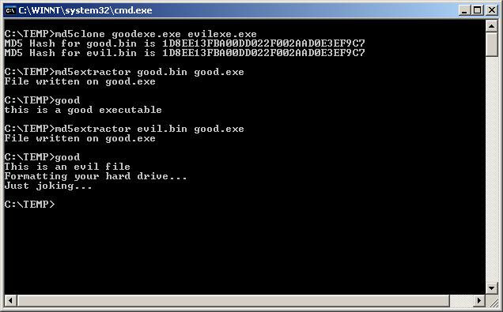

I wrote a C# program to demonstrate how the collisions found in MD5 can be exploited to create 2 files with the same hash value.

This image shows the proof of concept:

First we generate 2 binary files for distribution, using a harmless program (good.exe) and a dangerous one (evil.exe).

The MD5 value of both files is the same.
Then an extractor program pulls out different versions of the program, depending on which distribution file it is given.
In the first case we see the harmless program being extracted from good.bin, and it runs without problems.
In the second case, the user extracts our harmful program from evil.bin. Since the user trusts that the file has not been altered, because its MD5 hash is the right one, they run a program that in this case can do a lot of damage, like formatting the disk.

You can download the source for the proof of concept from this file:
Source code for Visual Studio 2003.

And the compiled version from here:
Compiled demo

This work was based on the following papers:

[http://www.cits.rub.de/MD5Collisions/](http://www.cits.rub.de/MD5Collisions/)

[http://www.doxpara.com/md5_someday.pdf](http://www.doxpara.com/md5_someday.pdf)

I published a more detailed article on [CodeProject](http://replay.waybackmachine.org/20090426080906/http://www.cits.rub.de/MD5Collisions/).
