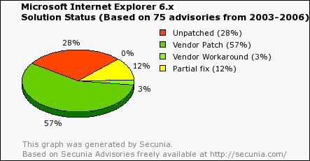
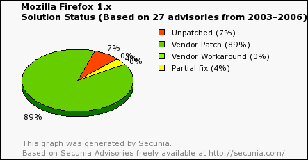
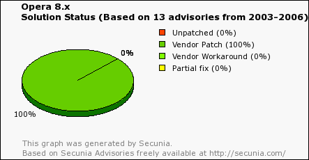

How do we judge browsers in a more objective way?

Fortunately, [Secunia](http://replay.waybackmachine.org/20060211180559/http://secunia.com/) can help us. The following charts show the number of flaws and the percentage of reported problems that were fixed, for Internet Explorer 6, Firefox, and Opera.
(These charts may change over time)

