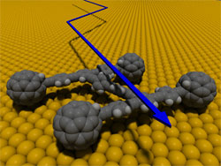

Scientists at Rice University developed the [world's first nanocar](http://www.rice.edu/media/nanocar.html).  

The vehicle is about 3-4 nanometers wide. By contrast, a human hair has a diameter of 80,000 nanometers.  
  
The car consists of a molecule containing the chassis, with axles and spherical wheels of pure carbon. A full article will be published soon in the specialized journal [Nano Letters](http://pubs.acs.org/journals/nalefd/).

The researchers' idea is to emulate similar structures that exist in biology, such as hemoglobin, which carries oxygen through the bloodstream to the cells.

With this chassis, it will be possible to build nanotrucks that can carry materials inside non-organic environments.

The problem is finding drivers for these new vehicles.

At least a nanobus would have no trouble in [Transantiago](http://www.lanacion.cl/prontus_noticias/site/artic/20051011/pags/20051011204836.html), Santiago's new transit system.
