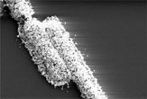

Bacteria are being assimilated by nanotechnology scientists.

For the first time, a microbe and a machine have been combined. This technological feat, pulled off by scientists at the University of Nebraska, let them create a bacterium coated in gold and silver that can sense humidity. This first "CellBorg" is a proof of concept for what could become an array of devices able to sense dangerous gases or other hazardous substances.

# How they did it

The scientists first covered a silicon chip with a layer of live "bacillus cereus" bacteria. Some of the bacteria got "hooked" between two electrodes on the surface of the chip, forming a bridge. The chip was then bathed in a solution containing tiny gold particles, each about 30 nanometers long. The nanoparticles attached to the long proteins on the surface of the bacteria, turning into gold-silver bridges that completed the circuit. These proteins are called teichoic acid molecules. They are negatively charged and provide a docking surface for the positively charged gold nanoparticles. Without the proteins the gold nanoparticles would repel each other, and the bridge between the electrodes could not form. By coiling around the nanoparticles, the teichoic molecules act as an insulator, creating what is called a dielectric barrier. "To any electronic person, that's a field day. You can go nuts with it," says Ravi Saraf, a chemical engineer at the University of Nebraska who led the discovery. The cellborg sensor is extremely sensitive: a drop in humidity from 20 percent to 0 results in a 40-fold decrease in current flow. Purely electronic sensors only experience a 10-fold drop.

The bad news for the assimilated bacterium is that it can survive only about 2 days in this environment. But even dead, its body can respond to changes in humidity and can be worked with for months. If scientists manage to coat the bacteria without having to kill them, then they could let cellborgs supply power to a circuit, instead of serving as a conductor to complete it.

Source: [Live Science](http://replay.waybackmachine.org/20060211180339/http://www.livescience.com/technology/051027_cellborg_sensor.html)
