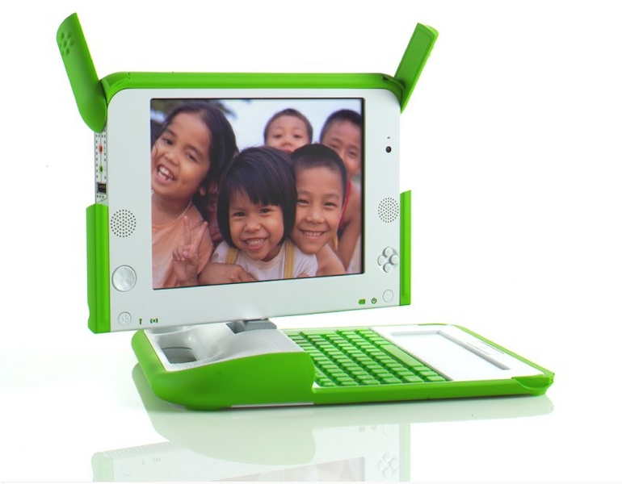

On the prototype, [Zuckerman tells us](http://www.worldchanging.com/archives/003707.html), work is actively under way, and there is a demo scheduled for November 16 at [WSIS](http://www.itu.int/wsis/). He got to see a sort of mockup in Negroponte's office.

The system is designed to work in 3 modes: laptop mode, book mode and game mode.

The design seems to be still under discussion, but what Zuckerman saw looks a lot like the following image:
 

The prototype would be the size of a large book, with a rigid rubber bumper around the edges that can be folded out to form a stand. A non-trivial problem is the "hinges", which have to allow some 340 degrees of freedom between the keyboard and the screen. According to Negroponte this part costs about 5 dollars, and it has a fairly complex mechanism to allow the rotation. The interesting part will be getting the cost of this part down to cents.

The keyboard Zuckerman saw on the prototype is detachable, probably because the idea is that keyboards will vary depending on the destination country. In China, for example, instead of a keyboard there will be a stylus and an area for drawing the ideograms (!?).

One of the biggest concerns, and the thing most talked about at MIT, is the screen, one of the most expensive components in a laptop. The preliminary designs mentioned using [e-Ink](http://www.eink.com/). That has reportedly been left for a second generation, mainly because of the power requirements of that kind of display.

The first generation will use LCD screens, but of a kind quite different from what we're used to seeing in laptops. The screen has a backlight, like PDA screens, but it's a technology called transmissive display. Normally these displays have the typical 3 filters, red, green and blue, applied to each pixel, but that makes them very power hungry. The final solution is fairly complicated: it has 3 backlights, red, green and blue, and microscopic lenses focus those lights to produce the final color of each pixel. Honestly, it's hard to picture this mechanism, but apparently it's the cheapest solution they found.

Since the display is fully custom, they are negotiating with suppliers in China to produce these displays at a fraction of the normal cost of such devices. Because of the power constraints, these screens will probably be less bright than what we're used to.

Negroponte's idea is for the power supplied by the crank to be 100:1, that is, 1 minute of cranking gives you 100 minutes of operation.

Zuckerman grilled Negroponte about the system's power, and Negroponte seemed to have an answer for everything: 12 volts of power? There are adapters for that. Voltage surges? Not a problem, given the system's modest power draw. Cooling? The machine won't use a fan, since it has no hard disk and the processor is relatively slow.

The only area where Zuckerman wasn't satisfied with Negroponte's answer was wireless network support. Remember that the proposed model is a network built by all the laptops joining together to form a mesh. All the work on mesh networks requires 2 radios per machine to provide a robust communications backbone, and the proposed machine has only 1 radio, probably to save costs. We'll have to see whether it works this way. It occurs to me that some time-sharing and frequency-hopping scheme, in the style of TDMA networks in cellular telephony, could work.

This series continues with the ULPN's software...
