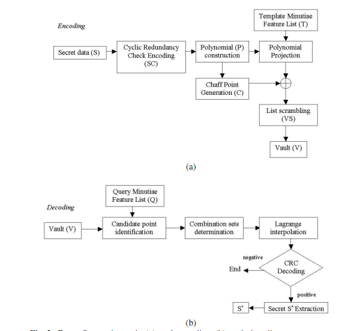

The marriage of biometrics and cryptography has taken a new step with the publication of the paper [Fuzzy Vault for Fingerprints](http://biometrics.cse.msu.edu/fuzzy-fingerprint-avbpa05.pdf) by U. Uludag, S. Pankanti and A. Jain of the [Michigan State University Biometrics Research Group](http://biometrics.cse.msu.edu/index.html).

Essentially, the algorithm hides a 128-bit key in a new structure, the fuzzy vault, a virtual vault that doesn't contain the key itself but the coefficients of a polynomial, which can only be reconstructed by acquiring the fingerprint minutiae.

Here is a diagram of the algorithm (click on it to see it in detail):

I wrote a description in English, which you can read at [darksideprogramming](http://web.archive.org/web/20060616110839/http://www.darksideprogramming.net/2005/11/the_keys_in_your_fingers.html).
