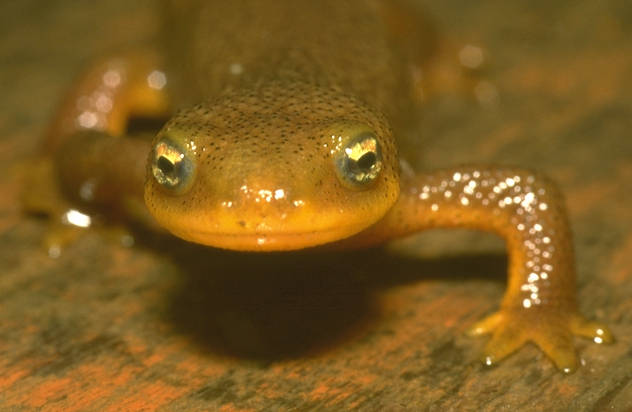
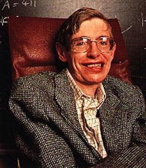
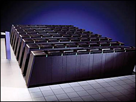

My maternal grandmother, who died recently, suffered
from [Alzheimer's](https://es.wikipedia.org/wiki/Alzheimer). When I learned
she had it I got worried, because I assumed it was a genetic
condition and that I therefore stood a chance of ending up with the same thing.
The same happened to me with cancer, since my father and my paternal grandmother both died
of it at around 40. I now know that statistically there is a
1 percent chance that I will develop that cancer,
but I also know that the type of cancer in question
is treatable today, and has a very good prognosis if it's diagnosed in
time, so I have to get my health checked fairly regularly. The
bad part is that the exam is rather unpleasant. But in the case of
Alzheimer's the probability isn't clear. The truth is that my
grandmother's daughters have a 50% chance of developing Alzheimer's, but
they must also carry certain mutations on chromosomes 1, 14
and 21. For me and my siblings the odds drop to 25%.

There is currently a test that looks for the presence of the APOE gene
(apolipoprotein E) by analyzing the APOE alleles,
especially the APOE e4 variant. Since we all inherit the APOE alleles
from each of our parents, having 2 copies of APOE e4
in our genes means a high risk factor.

## The torture of knowing

Would you take the APOE e4 test?

Personally, I wouldn't. One reason is that even though it's a risk
factor, there are people who have 2 copies of e4 in their blood and never
develop Alzheimer's. The second reason is that we still don't know for
sure what triggers Alzheimer's. It's known that great suffering
triggers Alzheimer's, and that emotional stability is an effective
prevention mechanism.

### Politics and biotechnology

But what happens if a government decides that the cost of supporting a
population with Alzheimer's isn't worth it, and makes the test
mandatory? How many people could be branded as pariahs for having 2
copies of the e4 allele in their blood?

On the other hand, knowing how many people may end up with Alzheimer's is an
important piece of data, since an estimated 8% of the population will suffer from
this disease. For insurance companies and for private and public health
administrators this information is extremely valuable. For the
government it's no small matter either, considering that in our country
the [age pyramid is inverting](https://www.censo2000.cl/),
which means the population at risk grows by the day, something
that is also happening in Europe.

This is one of the issues that
[the politics of the future](https://www.ricardodiaz.org/archives/2005/11/futuro_politico.html)
has to worry about, a subject Sebastián Escobar writes about on
[my brother's blog](https://www.ricardodiaz.org/). 
The film Gattaca
shows us a terrifying world in which genetic excellence is the ultimate
goal. In a different way, and before the discovery of DNA, Aldous Huxley
raised it too in [Brave New World](https://www.amazon.com/exec/obidos/redirect?link_code=ur2&tag=lanaturaledel-20&camp=1789&creative=9325&path=https://www.amazon.com/gp/product/9871138512?v=glance%26n=283155%26n=507846%26s=books%26v=glance).

## Understanding evolution

These dystopian nightmares come from the fact that most people
think of evolution as a mechanism of progress. When in
reality evolution is a mechanism of adaptation. We are no better
than a salamander, as one might conclude from the end of [Mr.
Escobar's article](http://www.ricardodiaz.org/archives/2005/11/futuro_politico.html).

The evolutionary difference between a salamander and a human is no greater than
that between a fly and a centipede. Each is adapted to its ecological
niche, and they are where they are for a reason. Salamanders are
chordates, same as us, but we sit on different branches of
evolution.

We have a different genome, and although we can define the level of
difference between our genome and that of salamanders, each species
contributes to nature's gene pool. In fact the regenerative
capabilities of salamander stem cells may help in
the fight against [Alzheimer's and Parkinson's](http://www.astroseti.org/vernew.php?codigo=208).

When you cut the leg off a certain kind of salamander, it regenerates the
lost limb completely. This kind of recovery is due to the
particular nature of the stem cells this particular salamander
has.

It may be that the mystery of how salamander legs
regenerate holds the answer to regenerating tissue, such as
neural tissue, leading to a cure for Alzheimer's, Parkinson's and so many
diseases that ravage our elderly population above all.

## Survival

Genetic manipulation is as old as humankind, or at least
it showed up back in our nomadic days. The wolf was genetically
manipulated through artificial selection, and we were able to create those faithful
friends that dogs are. Corn, wheat, cows: all of them are
the fruit of genetic manipulation and artificial selection.

Humans have always wanted to improve on nature, to live
better, to fight against death.

In nature the weakest are left behind: the small
injured fawn is abandoned by the rest of the herd and devoured by
the hyenas.

But we don't abandon our people because they have defects, or at
least we haven't so far. One of the most brilliant people
alive today suffers from a terrible degenerative disease of the
nervous system. I mean Stephen Hawking.
A man who tells us that God probably had no
choices at the beginning of the universe, which shakes the foundations of
many religions.

Why don't we abandon our sick? Even when they can be
as "impertinent" and "dangerous" as this celebrated
physicist. Because as a species we know that our survival comes from
the capabilities of our brain, and we have decided that even if one of
our own is not physically fit, their mind is valuable to the whole
group. In short, we know instinctively that a person, however
bedridden, carries an intrinsic value that we can call
soul, or mind, and that is very important for our survival.

That's why we have looked after our elders, because we turn to
them for the experience they have acquired. That experience, that
Potential Intelligence, as I call it, is valuable and it is stored
in them. That's why, when one of our elders falls ill with
Alzheimer's, it's a disaster for everyone. Because we don't just lose contact
with a soul; from a colder point of view, if you like,
we lose potential intelligence.

### Genetic software

In our struggle to survive as a species, we have investigated the
genetic code. Today we know that the genome is one more piece of software.

Indeed, the genetic code can be encoded as a base-4
language, and from there on it's a piece of cake for us
computer people. Something biologists are only now understanding, and which has
opened up a new branch of research called bioinformatics.

Today the world's largest supercomputer, Blue Gene, is designed
specifically to understand the mechanisms of protein synthesis.
It is the fastest calculating machine ever built.

But for a software developer the question is obvious: the
mechanisms currently used in bioinformatics are based on
brute-force algorithms. Clearly cells do it much better
and more efficiently. So what are those algorithms hidden
in the mitochondria and the other cell organelles? This is the problem of
**ontogenesis**, and it is one of the great challenges of biology and of
computing.

## Enhancement

The path is obvious: as our knowledge of
biological processes deepens, we will gain the ability to improve
our capabilities. That is what's called enhancement.

Evolution will take an impressive leap. The mechanisms of natural
selection will be displaced by arbitrary mechanisms dictated by
our desires. We will be able to evolve into new species adapted
to the conditions on other planets, for example.

That would be a different mechanism from the one proposed by the theory of
evolution, and unfortunately for the creationists, this one really would be a
mechanism of "intelligent design".

Will there still be humans?

It depends. If the changes are drastic, this kind of intelligent
design could create a species totally incompatible with
ours.

They will be a new species, different, neither better nor worse. A new branch of the
genus Homo, but created artificially.

This sounds like science fiction, but we know it's possible. Is it good, is it
bad?

I don't have answers, but I did find a hopeful vision in an
extraordinary 4-book saga called the "Hyperion Cantos", in
which the new species of humans and ours manage to accept each other
thanks to the intervention of that great force that binds
everything in the universe\...
