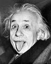

**"Einstein was wrong!"**

The line belongs to [Steven Bryant](http://www.relativitychallenge.com/about.htm), an American businessman who, while preparing to go back to college and get a PhD in physics, claims he found serious problems in Einstein's original papers.

With his own site, [RelativityChallenge.com](http://www.relativitychallenge.com/index.htm), and promotion through Google Ads, this gentleman has made quite a bit of noise with his theory, with which he aims to eliminate "the problems" of the theory of relativity, such as time dilation and the impossibility of traveling faster than light.

The truth is that his arguments rest on logic and mathematics, but without realizing it he makes mistakes of his own, mainly because he doesn't consider the physical arguments. You can read a detailed discussion in this Yahoo group.

Then again, he isn't the only one coming out with a theory like this; it seems Einstein's centennial has whetted the appetite of the [pseudoscientists](http://www.crank.net/einstein.html).

But it seems Einstein keeps surprising us, because apparently the cosmological constant, which he called his biggest blunder, is being vindicated by new discoveries.

Old Albert can keep sticking his tongue out at everyone who keeps challenging him.
