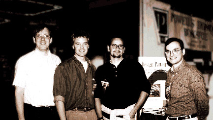

John Vlissides is probably one of the great inspirations behind modern software development.  
After a long fight with cancer, he died on Thursday, November 24.

Vlissides is known mainly as a member of the famous ["Gang of Four](http://www.c2.com/cgi/wiki?GangOfFour)", authors of the famous book "Design Patterns: Elements of Reusable Object-Oriented Software", a bedside book for many of us, and the ones who defined design patterns, a great step forward for software development.

Everyone who admires him is writing on his [Wiki page](http://www.c2.com/cgi/wiki?JohnVlissides), to show their appreciation for a person who was an inspiration to many software developers around the world.

