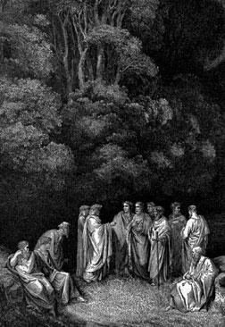

Was it a trick of Virgil's? Remember that Dante descended into Hell,
passed through Limbo, then spent time in Purgatory, and his beloved Beatrice
guided him to Paradise.

*The image that goes with this post is one of the beautiful drawings Doré
made to illustrate the Divine Comedy. It shows Dante, Virgil and
several figures from antiquity, such as Homer, Horace and Ovid.*

But now it turns out the Vatican [announces that Limbo doesn't
exist](http://eltiempo.terra.com.co/vidadehoy/30denoviembrede2005/ARTICULO-WEB-_NOTA_INTERIOR-2634981.html).

The good news is that all the children who were in Limbo moved on to
Heaven.

But wait, what about Virgil? Did he go to hell? Does he
deserve it for deceiving Dante?

Hmmmm, and what about everyone who never knew Christ and wasn't a child
when they died? Where did they end up?

Good thing I didn't go into Theology\....

Still, the problem of the ancients doesn't seem to have been solved.\
There's an
[interview](http://news.bbc.co.uk/hi/spanish/misc/newsid_4486000/4486152.stm)
on BBCMundo with Father Samuel Fernández, a dean at the Pontificia
Universidad Católica de Chile.

Limbo was never established as dogma by Catholic doctrine;
the concept is part of tradition, just like the three wise men, for
example (the Bible doesn't specify how many there were, nor does it give their
names).

I'm transcribing a few questions\
\...

**It is also said that John Paul II began by dismantling the traditional
view of heaven, hell and purgatory, which are not physical places but
states of mind. Heaven is the presence of God, hell is his
absence.**

**Does this mean that every day, through our states of mind, we can be
in heaven and in hell more than once?**

They are not states of mind but states of the soul. The thing is that we, as
human beings, create a mental representation for ourselves; we think in
categories of space and time. What John Paul II said was that we
should not identify heaven with the way we imagine heaven.

I remember that when those catecheses came out there was quite a stir, but
there is really no theological novelty in them.

**If heaven is full communion with God, it would seem that death is not
necessary for that communion. That heaven can be reached in
day-to-day life, on this Earth.**

Total fullness only comes after death, but here we
experience glimpses of that full communion through our human
experiences: love, an achievement, a deeper understanding of
things.\
All those positive experiences are a spark, a preparation for
full communion.

The doctrine of the church recognizes the freedom of the human being. If a
person acts with integrity, according to their heart, even when
they don't profess any faith, isn't that a path toward full
communion? Aren't there, beyond the sacraments, other paths to salvation?

**Through the incarnation, Christ has united himself with every human being; there is an
orientation of humanity toward Christ, even unconsciously. There is the
baptism of desire, and finally Saint Thomas Aquinas himself says that
grace is not chained to the sacraments.**

God has the ability to act in whatever way he wants. Naturally,
God's mercy reaches much further than our
ideas do.

To finish: if God reaches much further than our
ideas do, why does the Church feel entitled to interpret and
explain to us what the afterlife is like?
