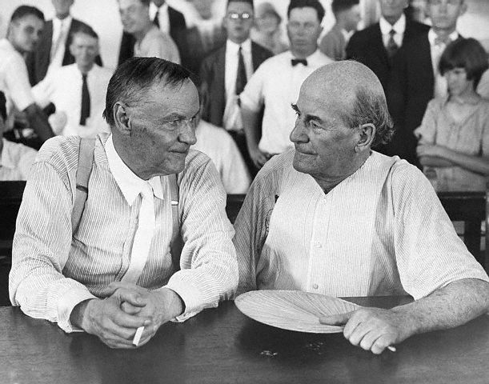

[Intelligent design](http://es.wikipedia.org/wiki/Dise%C3%B1o_inteligente) is the new incarnation of [fundamentalist creationism](http://es.wikipedia.org/wiki/Creacionismo), which explains the origin of species according to the literal interpretation of the book of Genesis.

For years in the United States, fundamentalist groups have opposed the theory of evolution because they consider it false and contrary to the teachings of God. A judge ruled that teaching this doctrine i[s illegal in Pennsylvania](http://www.livescience.com/othernews/051220_id_no.html). At least there's now one less state that will carry on with this nonsense.

This article shares its name with a [1960 movie,](http://www.imdb.com/title/tt0053946/) starring Spencer Tracy. The movie, in turn, is based on the famous [Scopes case](http://en.wikipedia.org/wiki/Scopes_Trial).

The Scopes case is famous because it pitted two of the most notable lawyers of their time against each other. On one side was [Clarence Darrow](http://en.wikipedia.org/wiki/Clarence_Darrow) (Henry Drummond in the movie), defending the teacher [John T. Scopes](http://en.wikipedia.org/wiki/John_T._Scopes) (Bertram T. Cates in the movie). Accused of teaching the theory of evolution, Scopes faced the wrath of the little town of Dayton, Tennessee, for daring to teach something forbidden by the laws of that state, in 1925. In the role of prosecutor was another brilliant lawyer, and former presidential candidate,[ William Jennings Bryan](http://en.wikipedia.org/wiki/William_Jennings_Bryan).

Reading about this trial is really interesting, which is why you'll find Robert Silverberg's account in the continuation of this article, but once again, I suggest you watch the movie, not only for the subject, but because it may well be one of the best movies of all time.

Oh, and the line comes from Proverbs 11:29: "He that troubleth his own house shall inherit the wind: and the fool shall be servant to the wise of heart."

## A strange trial
MAN BEFORE ADAM

ROBERT SILVERBERG

EDITORIAL DIANA S. A., MÉXICO, 1965
Translated from the English by RENÉ CÁRDENAS BARRIOS

## Monkeys on trial

A strange, dramatic and grotesque event took place in 1925 in the town of Dayton, Tennessee. A young schoolteacher named John Thomas Scopes was put on trial for violating a law of the State of Tennessee. The grave offense Scopes was charged with was teaching Darwin's theory of evolution to a group of high school students.

[...]
