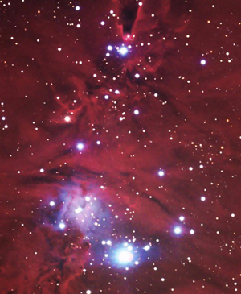

The truth is I didn't post a Christmas greeting because I was hoping to publish something more important; unfortunately it isn't ready yet.
But an unexpected gift dropped in thanks to blogmemes, and it's this image of Herschel's Christmas Tree. It sits in the constellation Monoceros (the unicorn), about 2,600 light-years from Earth.

Thanks to blogmemes I found out about NeoFronteras, which had this image, one of the satisfactions of this kind of project.
