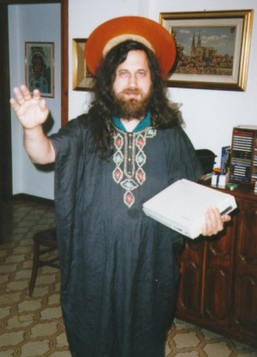

Juanjo Marín left me this comment:

> "The FSF is the recognized point of reference for determining what free software is. I think you are contradicting yourself by supporting free software on the one hand and loathing the ideology behind it, which basically consists of defending the freedoms it implies.

P.S.: If you think Richard Stallman is not a suitable representative to speak about Free Software, get that looked at. If you don't like him, fine, but you have no right to dismiss his importance within free software."

The first sentence is a tautology. The FSF, for those who still haven't heard, is the Free Software Foundation. The foundation for "free" software. Which was founded by Richard Stallman.

Saying it is a recognized reference on free software is like saying the Catholic Church is a recognized reference on the Immaculate Conception.

I support free software, as I have for many years. Both as a user and as a developer. But I think people are getting lost, and they are taking free software to be something it isn't.

There is no contradiction in my attitude. [Freedom ](http://replay.waybackmachine.org/20071029051411/http://www.lnds.net/2006/02/libertad.html)is about thinking for yourself, something that scares most people, which is why they turn to gurus to do their thinking for them.

That's why so many never question the concepts of free software and the GPL, and use them or reject them without even understanding them.

Free software has nothing to do with right or left, or with wealth or poverty, and it isn't one of the [pillars of the Age of Aquarius](/en/blog/lnds/2005/09/09/free-software-and-the-age-of-aquarius/) either.

By the same token, free software isn't the exclusive vision of the FSF, much less the personal vision of RMS, to whom I grant plenty of merit, such as his thinking behind the GPL, namely:

  * The freedom to run the program, for any purpose (freedom 0).

	
  * The freedom to study how the program works, and adapt it to your needs (freedom 1). Access to the source code is a precondition for this.

	
  * The freedom to redistribute copies so you can help your neighbor (freedom 2).

	
  * The freedom to improve the program, and release your improvements to the public, so that the whole community benefits (freedom 3). Access to the source code is a precondition for this.

I think freedom -1 is missing: the freedom to use the GPL or not. But that's another story.

Either way, saying that I'm contradicting myself because I disagree with Stallman is illogical.

When Juanjo tells me to get that looked at, I'd like to know which part of my body he means.

Finally, that Richard Stallman has totalitarian habits is undeniable.
