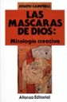

Today is [World Book and Copyright Day](http://replay.waybackmachine.org/20071028182259/http://portal.unesco.org/culture/es/ev.php-URL_ID=5125&URL_DO=DO_TOPIC&URL_SECTION=201.html), and [Ricardo ](http://replay.waybackmachine.org/20071028182259/http://www.ricardodiaz.org/)has thrown me a challenge (a meme?), which consists of recommending a book.

Hard, mostly because I've read so much and it's tough to choose. I don't think this will be enough, so we're going to create a specific category for recommending books.

## Between science and myth

When a friend gave me "The Hero with a Thousand Faces", I had spent many years reading nothing but technology books and science fiction. It was while visiting his house, snooping around his library, that I found this book. That was how I first read Joseph Campbell. I had heard something about the book, since George Lucas mentions it as one of the most important influences on the creation of his Star Wars trilogy.
The richness of mythology, the value of myths and of rites in our society are condensed in this small book, which is a foretaste of Campbell's great work, "The Masks of God", my second recommendation. This is a thick work, in 4 volumes, that explores mythology along two dimensions, the historical and the geographical.

Campbell is a great thinker, and teacher. Although many people read him looking for some kind of spiritual guide, Campbell never tried to be a guru, or a spiritual master of any sort. He simply worked out a theory of mythology, discovered the structure of myths, and highlighted the value of myth for the social psyche.

Myths are to societies what dreams are to individuals. That sentence sums up what these books hold.

I'm a person with a scientific education, and of course I can't fail to recommend a couple of science books.
The first is _Catching the Light, by Arthur Zajonc_ (ISBN: 8489691029). A beautiful book that tells us the history of Light, from the conception of ancient religions, which speak of a struggle between a God of Light and another of Darkness, to the studies devoted to it by Da Vinci, Newton, Goethe and Einstein. Written by a physicist, this book is the history of light from every perspective: mystical, artistic, philosophical and, mainly, scientific.

## Great books

_Decisive Moments in History, by Stefan Zweig_(ISBN: 84-261-0102-X). If you like history, you must read this book. Zweig is a great storyteller, and this book is a good example of his style, yet rich in details that are astonishing, to say the least, and a pointer to how sometimes a small detail can mean the fall of a civilization.

"Gog and The Black Book", and "Life of Christ", by Giovanni Papini. Like Zweig, Papini is a great writer, but Papini is a great provocateur, and a sincere and passionate convert. I don't know whether Gog was written before his conversion to Christianity, but it's a provocative book, and if anyone wants to learn how to provoke, to shake up the mind, Papini is a great master.
