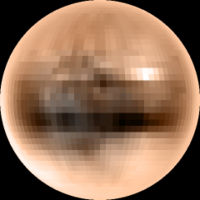

It turns out astronomers are no different from the rest of
the *users*: *"once the system is stable they bring in new
requirements, and changes have to be made"*.

I'm talking about the recent reclassification
of [Pluto](http://es.wikipedia.org/wiki/Plut%C3%B3n_%28astronom%C3%ADa%29),
under which this celestial body stops being a planet and becomes
a "dwarf planet".

The reason is that the new definition requires a planet to have
a gravitational field strong enough to clear the neighborhood
around its orbit of other celestial bodies.

### Advantages of the change

Now there are 8 planets, which helps us parents when we have
to do the homework on the solar system. The little models are going to be
simpler. The time we'll spend helping memorize the order of
the planets drops by 11%.

### Disadvantages of the change

The teachers may decide to add the dwarf planets, in which case
the little models get a lot more complicated. Or it may occur to them to add the
[plutinos](http://es.wikipedia.org/wiki/Plutino), and then studying
the solar system really does get complicated.

### Curiosities and cultural impact

The Disney character Pluto was named after the
discovery of this planet; the character first appeared
in a 1930 cartoon.

The astrologers haven't weighed in on the matter, so I
would be wary of any birth chart that includes Pluto :).

Mythological impact: it turns out that Pluto's brothers, Jupiter and
Neptune, have enormous planets to represent them, while Pluto
is being pushed even further aside. I don't think the neo-pagans and
mythologists will like that much.

It turns out the name Pluto was suggested by [Venetia Burney](http://replay.web.archive.org/20071028181216/http://en.wikipedia.org/wiki/Venetia_Burney),
who proposed it to her grandfather when she was 11. The name has the
peculiarity that its first two letters, PL, evoke the initials of
Mr. [Percival Lowell](http://en.wikipedia.org/wiki/Percival_Lowell), the astronomer who launched the search for it (*vanity, my favorite sin*).

[Venetia is 87 years old today](http://news.bbc.co.uk/1/hi/sci/tech/4596246.stm).

## Eppur si muove

Remember that until 1930 nobody knew about Pluto, and that every year our
view of the solar system changes. In fact, if we had to build a
complete model it would be a major undertaking.

I remember that when I was a kid Jupiter had only 12 moons, and the only
planet with rings was Saturn. Today we know that Jupiter has 63 moons, and
that the [Jovian planets](http://en.wikipedia.org/wiki/Jovian_planet)
have rings.

### The history of discoveries

This change, which comes from the advance of science, can be contrasted
with the theological change that came with the
[elimination of Limbo](/en/blog/lnds/2006/08/27/dante-was-wrong-limbo-doesnt-exist/).

These are paradigm changes: the view of the world changes, but because of a
change in the definitions we set for it. I find these
changes challenging, because in the end it means that
knowledge "si muove".
