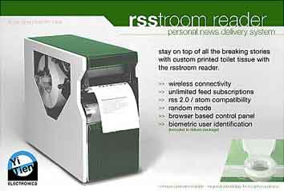

Of all the uses of paper, this one seems the strangest. The RSStroom Reader is "a toilet paper dispenser that hands you paper printed with random posts from RSS, so that before using the paper you can read a little and be up to date on everything." That's how it is described by "[Mardito's blog: Los Links del Día](http://replay.web.archive.org/20071011063529/http://www.mardito.com/weblog/?p=1766)"

The truth is that this is a [fictitious product,](http://replay.web.archive.org/20071011063529/http://www.djspyhunter.com/blog/2005/12/05/rsstroom-reader-toilet-paper-printer/) created by a blogger with a lot of imagination.

In any case, the idea would at least optimize paper use.

## Receipts and change on TranSantiago

With great fanfare the new BIP card is announced; with a [pilot in which 1,000 users](http://replay.web.archive.org/20071011063529/http://forum.skyscraperpage.com/showthread.php?t=114247) will use this card, the rollout of [transantiago](http://replay.web.archive.org/20071011063529/http://www.transantiago.cl/), Santiago's new public transit system, moves forward.

On television the minister explains to the reporters how the system works: you just hold the card up to a sensor, a beep will sound ("hence the name") and the user (they're no longer passengers) can board the bus.

Extraordinary!

But the reporter, clever fellow, already has his gotcha ready: "but Minister, if an inspector gets on, how can the passenger prove he used his card?"

Crickets...

The minister's silence says it all. Apparently nobody had thought of that situation.
Point to the reporter.

But the minister recovers and tells the reporter to be patient, "we're going step by step", transantiago is a complex matter, and "that's what this trial run is for, to tune these little details".

I'm sure the vendor will be asked to add a printer to issue receipts.

## Use the card, or pay the consequences

According to a piece in "La Revista del Transporte", a supplement of the newspaper Las Ultimas Noticias:

> The buses are being fitted out at the facilities of the Mercado de Santiago (Mersan), by 340 Sonda workers and technicians. Each bus carries equipment inside costing 18 thousand dollars (about CLP 10 million). Among the items installed are two validators that deduct the fare from the contactless card, which can be either the BIP (student) or the Multivía, both with compatible technologies. Only half of the buses will have a device for exact payment in coins, which will not give change, since the idea is to encourage the use of the card and punish paying with loose change

What do you think?
