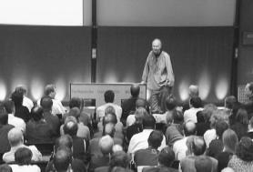
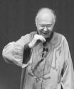

We all have our personal heroes, representative men,
especially from the field we work in.

One of my oldest personal heroes is the professor and
programmer [Donald
Knuth](http://web.archive.org/web/20070513053932/http://www-cs-faculty.stanford.edu/~uno/).

Author of the famous [Art of Computer Programming](http://web.archive.org/web/20070513053932/http://en.wikipedia.org/wiki/The_Art_of_Computer_Programming),
and a great programmer. Creator of
[Metafont](http://web.archive.org/web/20070513053932/http://en.wikipedia.org/wiki/METAFONT)
and
[TeX](http://web.archive.org/web/20070513053932/http://en.wikipedia.org/wiki/TeX),
used by thousands of scientists today to publish their papers.

Donald Knuth is professor emeritus at Stanford University, and
probably the oldest geek in existence. For example, the version numbers
of TeX approach the transcendental number Pi: the first
version was 3, the second 3.1, the third 3.14, and so on.
He also has the habit of paying 2.56 dollars for every error
found in his books (because "256 cents is one hexadecimal
dollar").

Imitating the famous physicist [Richard Feynman](http://web.archive.org/web/20070513053932/http://en.wikipedia.org/wiki/Richard_Feynman),
he has the custom of opening the last class of every course he teaches
to any question on any subject, except
those about politics, religion, or the final exam.

One of these question-and-answer sessions was held as a
lecture on October 5, 2001 at the Technische Universität. The
session was transcribed in the [Notices of the AMS](http://web.archive.org/web/20070513053932/http://www.ams.org/notices/)
([American Mathematical Society](http://web.archive.org/web/20070513053932/http://www.ams.org/)).
You can [download it](http://web.archive.org/web/20070513053932/http://www.ams.org/notices/200203/fea-knuth.pdf)
from that site, but I want to share with you
some of the questions I found most interesting. I invite you
to meet one of the great thinkers of computer
science (the headings are my fault).

## Computer science

Knuth opens by explaining the format, which he copied from Feynman's
classes at Caltech, and then threatens to walk out when nobody asks
anything. The first question is about the PITAC report to the US
president and its priorities: better software engineering, a teraflop
computer, a more secure and faster Internet, and the socioeconomic
impact of information on networks. Knuth calls it a brilliant solution
to the problem of what to present to a president, but what he would
really like to see is thousands of computer scientists being allowed
to do whatever they want.

> **Knuth**: Computer science is a tremendous collaboration of people
> from all over the world adding little bricks to a massive wall. The
> individual bricks are what make it work, and not the milestones.

Asked about cryptographic algorithms, and about politicians' efforts to
limit cryptography research, he says the area is one of the most active
and exciting of the last ten years, with spectacular and beautiful
results, though he admits he isn't especially good at it. As a religious
man he feels his secrets are public knowledge in some sense anyway, so he
doesn't need to encrypt everything; but he wouldn't like that openness
used against him, so he supports a high level of secrecy, while leaning
toward the side that wants the authorities to have some way of breaking
some keys in extreme cases.

## God and computing

A questioner brings up the mathematicians' idea that God has a "Book of
Proofs", and asks for some entries from the "Book of Algorithms". Knuth
credits the idea to Paul Erdős, recalls mathematicians telling him in
the 1960s that computer science would be a mature discipline once it had
1,000 deep algorithms (he thinks we have probably reached 500), and
offers Euclid's algorithm and its binary counterpart as examples of
algorithms that are beautiful and immortal.

Asked about the relationship between God and computers, he describes his
book 3:16 Bible Texts Illuminated, in which he used random sampling,
a method computer scientists often use to understand a complicated
subject, to study sixty verses of the Bible, illustrated by sixty of
the world's best artists.

> **Knuth**: In the book, I don't give answers. I just say I think it's
> good that life should be an ongoing search. The journey is more
> important than the destination.

## The future of computing

Asked for the five most important problems in computer science, Knuth
answers that he doesn't like the "top ten" business; it's the bottom ten
he likes, the little stones that make up the wall.

On quantum computing he says he doesn't know much: it is a very
different paradigm from the one he is used to, and he compares it to the
movie "Lola rennt" ("Run Lola Run" in the US), where the plot plays out
three times down three different branches. He is good at non-quantum
computing, he says, and it is quite possible that if quantum computing
takes off he won't be able to do anything new; it looks like a different
world from his.

Will we ever have intelligent machines, and should we? He says estimates
of how soon have always been exaggerated, and that he still sees no sign
of getting close to the central problem of understanding what cognition
is. Books by Hans Moravec and Ray Kurzweil say that in twenty or thirty
years we will have machines smarter than humans.

> **Knuth**: My attitude is, if that's true, more power to them. If they
> are smarter than us, so what? Then we can learn from them.

He adds that two weeks earlier he was in Greece at the launch of a new
book by Christos Papadimitriou, chairman of computer science
at Berkeley, who published a novel in Greek called
"The Smile of Turing"; he doesn't want to give away the story, but
when it is published in German or English you'll find a good discussion of
artificial intelligence and the Turing test in it.

The most promising model of how the brain works that he has seen treats the
brain as a dynamic genetic algorithm that runs all the time.
While he talks, the listeners' brains hold a lot of competing theories
about what he is going to say. It's survival of the fittest, a
continuous battle between competing theories; some reach the
surface and actually enter consciousness, but the others are
all there. The model seems to have
the right properties to account for how we do what we do
given the relatively slow response time of neurons.
But he is no expert on this, he says.

## On software patents

What does he think of software patents, the subject of a big debate in
Europe? Knuth is against patenting things any student would be expected
to discover; there have been many unpleasant US software patents on
completely trivial ideas, and the way patenting was going threatened to
bring the software industry to a standstill. For something nontrivial,
like the interior point method for linear programming, there is more
justification for a right to license the method for a short time. Raised
in the culture of mathematics, he doesn't charge anyone a penny for
using a theorem he proved; charging for services, customization and
improvements is fine, but the algorithms themselves shouldn't be
proprietary.

> **Knuth**: Algorithms are inherently mathematical things that should
> be as unpatentable as the value of π.

There is an interesting issue all the same, he says. Could you hold a
patent on a positive integer? It is not inconceivable that a million of
today's greatest supercomputers, left running, could
compute a certain 300-digit constant that
would solve hard problems by taking the gcd of the constant
with an input number, or by some other entertaining combination. That
integer would take a massive amount of computing time
to find, and if you knew it you could
do all kinds of useful things. Now, is that integer really
discovered by man?\
Or is it something given by God? When we start thinking about
complexity, we have to change our point of view about what is
natural and what is invented.

## The art of programming

What is the connection between mathematics and computer programming
viewed as an art? "Art is Kunst", Knuth begins, and the German word for
artificial is also the word for artistic. Both computing and mathematics
differ from other sciences because they are artificial; they are not in
nature, they are totally under our control, and when we solve a problem
we can prove we have solved it. Still, he can feel when he is wearing
one hat or the other: part of him likes mathematics, and part of him
likes hacking Emacs.

> **Knuth**: I think of programming with beauty in mind, as being
> something elegant, something that you can be proud of for the way it
> fits together.

The last question is about the checks he sends to people who report
errors in his books: nobody ever seems to cash them, so how much would he
have to pay if they all were cashed at once? Knuth says there is a man
near Frankfurt who would probably have more than $1,000 if he had cashed
all the checks sent to him, and a man in Los Gatos, California, whom he
has never met, who cashes a check for $2.56 about once a month and has
been doing it for years. He has written more than 2,000 checks over the
years, averaging more than $8 each, and even if everyone cashed theirs it
would be more than worth it to him to know that his books keep getting
better.
