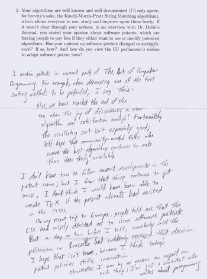

Don't think I've forgotten the problem of [paper use](/en/blog/lnds/2006/09/14/less-paper/). What happened is that I ran into Knuth's lecture and couldn't resist translating it and [publishing it](/en/blog/lnds/2006/09/23/knuth-answers-all-questions/).

But I also remembered a peculiar fact about Knuth, which is that he doesn't use email. The explanation is on his website, in one of [the frequently asked questions](http://replay.web.archive.org/20071016222822/http://www-cs-faculty.stanford.edu/~knuth/email.html).

For example, the image that goes with this post is one of Knuth's answers to a [questionnaire](http://replay.web.archive.org/20071016222822/http://www.freesoftwaremagazine.com/articles/interview_knuth/) that was sent to him and published in [Free Software Magazine](http://replay.web.archive.org/20071016222822/http://www.freesoftwaremagazine.com/).

Notice the handwriting, and the way he sets off a quotation from his book. With a rule down the left side. Knuth is a born typographer.

Besides, Knuth doesn't use email; if you want to get in touch with him you have to send him a letter, by regular mail.

His secretary takes care of collecting and sorting his correspondence. On top of that, the emails sent to the Art of Computer Programming account, and to the account that handles TeX bugs, are printed out by his secretary and he reads them later.

When a printed email isn't a suggestion or an error report, he uses the paper for proof printouts of his books.

But the best part is the reading schedule. Knuth reads his mail, the non-urgent kind, once every three months. You can always send him a fax, but the trouble is that he reads those every six months!!

To justify this, he quotes Umberto Eco:

> "I don't even have an e-mail address. I have reached an age where my main purpose is not to receive messages." --- Umberto Eco, quoted in the New Yorker

Knuth says:

> Email is a wonderful thing for people whose role in life is to be on top of things. But not for me; my role is to be on the bottom of things. What I do takes long hours of studying and uninterruptible concentration. I try to learn certain areas of computer science exhaustively; then I try to digest that knowledge into a form that is accessible to people who don't have time for such study.

Thanks to Knuth, and to many like him who sit in the lowest layers, like foundations, we can make better use of the little time we have (which is email's fault :).

I like his vision, of placing himself at the base, at the very bottom, providing support.

Which layer are you in?
