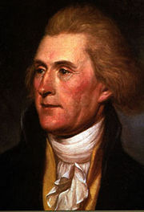

Thomas Jefferson, like every human being, had contradictions, some of which have been harshly criticized by his fellow citizens. How is it possible that the man who "wrote all men are created equal" owned slaves, and was a racist on top of that. For those interested in Jefferson's contradictions, [this article](http://memory.loc.gov/ammem/collections/jefferson_papers/mtjessay1.html) (it's in English) can be very educational.

To me, many of his ideas look very similar to those held by the English proto-socialists Isaiah Berlin tells us about in "The Sense of Reality" (Editorial Taurus, Alfaguara 1998). In the end Jefferson aspired to the end of the regulating or interventionist state and aspired to absolute freedom for citizens. He can hardly be branded a hard-line capitalist, which is how Galli's article presents him. Jefferson's political ideas are not very deep; John Adams and James Madison tried several times to tell him that his efforts in political philosophy were superficial and suffered from a very juvenile naivety (see [The Contradictions of Thomas Jefferson](http://memory.loc.gov/ammem/collections/jefferson_papers/mtjessay1.html))

Ricardo Galli answers me in a comment on my previous article:

> "Jefferson did [1] oppose including copyright in the constitution, and he opposed the amendment to the constitution. And as I said several times, they left the authority to Congress."
> [1][http://onlinebooks.library.upenn.edu/webbin/bparchive?year=1999&post=1999-0](http://onlinebooks.library.upenn.edu/webbin/bparchive?year=1999&post=1999-0)

Schopenhauer says "that people take it badly when we don't agree with them, when they should be worrying about presenting their arguments in a better way" (I'm quoting from memory).

What I'm criticizing is the lack of rigor. People seem to be forgetting that there are books and documents that aren't indexed by Google, and seem to think that citing obscure sites on the web amounts to sufficient proof.

I already said that the letter being quoted has nothing to do with the debate over the constitution, because it was written several years later. But besides that, Jefferson didn't take part in the constitutional convention of the United States, because he was in France at the time.

The quotes at the link Ricardo Galli provides come from letters between Jefferson and Madison, in which they discuss what we now call copyrights. Let's remember that Jefferson ends up accepting the text on the protection of rights over writings, inventions and discoveries, but he manages to impose several of his criteria, quite reasonable ones of course, such as the fact that these rights are limited in time, and Congress's authority over these matters. Later he makes sure he drafts the first patent law so he can include much of his thinking in it.

Jefferson's famous letter to Isaac McPherson starts out discussing the provisos that were taken into account when Mr. Evans was granted his new patent. The core of the letter, which is a gem of writing, is the part that includes this beautiful sentence: _"he who lights his taper at mine, receives light without darkening me."_.

In this core of the letter Jefferson clearly lays out his ideas about property in ideas, and establishes the famous argument about the difference between property in physical things versus property in ideas.

The text is eloquent, elegant and well written. We would have a hard task ahead of us if we wanted to oppose this argument.

I'll only venture that these criteria can't be applied so easily, because in Thomas Jefferson's time there was no software, nor the manipulation of information as we can do it now. Ideas are free, but we shouldn't confuse ideas with information, which are things of a different nature.

But let's leave Jefferson in peace. At the end of his letter to McPherson he asks:

> "In thus frankly committing myself to you, I trust you will feel it as a point of honor and candor, to make no use of my letter which might bring disquietude on myself."
