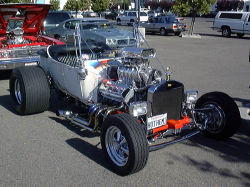

[Hot Rods](http://replay.waybackmachine.org/20071029084924/http://www.hotrod.com/) are hand-built cars, usually made from some old car (usually a Ford). The original idea was to improve the car's performance by reducing its weight (removing the roof, the windshield, etc.), lowering it, swapping or tuning the engine, fitting wider wheels, and of course painting it in loud colors.

There's a whole subculture around this "art", and it's reaching our country, mainly thanks to the popularity of several cable shows.

This is a typical product of American culture; Americans probably don't know what to do with their time. Still, you have to remember that the car is a central element of Yankee culture, so it's only natural that this would spring up in that country.

For Hot Rod practitioners, the product of their work is **a work of art**. We can say, without any trouble, that there is a **Hot Rod culture**. However bizarre it may seem to us, whether we like it or not, the Hot Rod is a cultural phenomenon.

In this culture, **the creators and the owners** are, as a rule, the same person. A fan with enough time, money and mechanical know-how, with help from others, acquires a car, comes up with a design and builds a new kind of car, a design that never occurred to the original manufacturers.

If they are works of art, then the **owners** of those cars are also **authors**, or **creators**. In a stricter sense they are innovators, but often the product is so different from the original that we can speak of creation.

Ownership of a Hot Rod is clear: it belongs to whoever buys the car, **if its author puts it up for sale.**

**Any artifact created by man is the product of an idea.** The artifact can be tangible, like the body of a Hot Rod, but also intangible, like the design, or the vision the hot rod's creator had.

When the creator of a Hot Rod captured his vision in a chassis and a body, what he did was capture his intangible creation in something "tangible".

That's why I say there is no difference between ownership of the tangible and of the intangible, because in the end every artifact is the product of ideas, which arise in the mind.

But there's more: if the author of a hot rod imagines the most beautiful of car bodies and doesn't capture it in anything, then in practice it doesn't exist, and therefore he can't possibly claim rights over that vision.

That idea is like Schrödinger's Cat, it exists and doesn't exist at the same time; only when that idea becomes tangible can we be sure it exists.

In the end, every idea has to be made tangible somehow. In a piece of writing, in a recording, in the design of a car, or in the code of a program.

I don't believe in the "intangible", because really everything is tangible, even if only temporarily.
Some things will be clumps of atoms, but there are others whose tangibility is subtler; they may happen during the brief interval of a synapse, but that doesn't make them any less tangible.

If tangibility is something so subtle, it's obvious we'd get lost in the arguments.

The problem is that when we talk about property, a lot of people don't like the term. That's valid, because just as [Carlos says](http://replay.waybackmachine.org/20071029084924/http://eldiabloenlosdetalles.net/2006/11/18/propiedad-intelectual-derechos-de-autor-duenos-vs-creadores/), it would seem that culture is in danger because of intellectual property.

In reality, culture has never been in danger, and never will be. What's in danger is intellectual property, not culture. As long as there are people, there will be culture; we can talk about the quality of that culture, but that's another discussion.

When someone pirates, they endanger a creator's rights, but they don't endanger culture, as some scandalously announce. Whether these rights are property rights to me and authors' rights to [Carlos ](http://replay.waybackmachine.org/20071029084924/http://eldiabloenlosdetalles.net/2006/11/18/propiedad-intelectual-derechos-de-autor-duenos-vs-creadores/)is by now almost a matter of semantics.

Let's take the issue of the right or access to culture out of the discussion about intellectual property. They are different discussions; if we lump them together we get confused.
