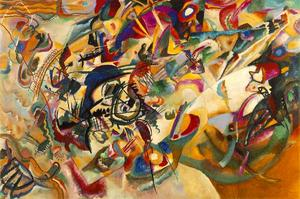

When you first approach a work of abstract art, like this beautiful painting by Kandinsky, the first thing you usually ask yourself is **"what is this?"**, or also **what did the painter mean to express?**.

Some approach it naively, some reject this kind of art.

Others give up on the questions and devote themselves to appreciating it aesthetically.

For Kandinsky a work of art was effective _if it arose from an inner need of the artist and if the artist's original impulse is evoked in the viewer through the artwork and its reception_.

The question Kandinsky would have liked to hear is: **what does this painting evoke in me?**.

> "Music is the ultimate teacher"

Aspiring to the evocative nature of music, the most supreme of the arts, was at bottom the Russian painter's ambition.

If we listen to a melody, we're very unlikely to ask ourselves anything; the music will stir feelings in us, bring back memories, evoke emotions.

## The functional questions

Unlike with a painting, when we're faced with software the first thing we ask is what is it for?, or equivalently, what does this program do?

We rarely ask what a work of art is for, unless we're psychologists :smile:.

When we're going to develop software, the first thing we professionals in the field do is the _requirements analysis_. What we're trying to find out is what the software is going to be used for. From that we produce _the functional design of the system_, that is, we define the domains of the inputs and the outputs, along with the functions that transform those inputs into the desired outputs.

This is essentially the **functional argument**, which helps us explain why software is different from other intellectual creations.

It's one of the many arguments showing that the **Nature of Software** is so different from anything else human beings have ever created in their history.

In a [recent article](http://replay.waybackmachine.org/20081014084254/http://www.quemarlasnaves.net/2006/11/21/propiedad-intelectual-o-derecho-de-autor-parte-dos/) by Claudio Ruiz, we're told that all intellectual creation is subject to copyright.

However, this notion is wrong, and it can't be applied so directly to software, because software is **essentially different**, and can't be equated with a work of art, much less with a literary work, as the Berne Convention holds, and as _Raspu_ reminds us

Legislation should start to reflect the essentially different nature of software.

One more reason to rethink our notions of intellectual property.
