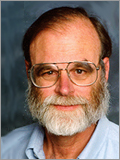

It's true, there is no Nobel Prize in computing, despite what [La Tercera has reported](http://replay.waybackmachine.org/20090426081032/http://www.latercera.cl/medio/articulo/0,0,3255_5702_250444463,00.html) (thanks [Claudio](http://replay.waybackmachine.org/20090426081032/http://eldiabloenlosdetalles.net/2007/02/05/%c2%bfnobel-de-que-me-dijo-mensaje-a-la-tercera/) , since I don't read La Tercera, I would never have found out :)

Legend has it that Nobel hated mathematics, or considered it a sterile science, which is why this prize explicitly does not exist for mathematics; mathematicians aspire to the Fields Medal.

In computing there are several prizes. Probably the most prestigious is awarded by the ACM, the famous Turing Award.

The news of the disappearance of Jim Gray, who received the Turing Award in 1998, has caused quite a stir. Jim Gray is one of the pioneers in the development of databases and transactional systems. For years he has headed the Microsoft Research division in the San Francisco area.

Lately Jim Gray has been working on the development of [Terra Server](http://replay.waybackmachine.org/20090426081032/http://www.terraserver.microsoft.com/), [Sky Server](http://replay.waybackmachine.org/20090426081032/http://cas.sdss.org/dr5/en/), and [Virtual Earth](http://replay.waybackmachine.org/20090426081032/http://local.live.com/), projects that are, to some extent, being used to look for him.

Indeed, there is an effort by the scientific and computing community to find Jim Gray. Many people at NASA and astronomers around the world have worked with him, and they are helping by using [Amazon's Mechanical Turk](http://replay.waybackmachine.org/20090426081032/http://www.mturk.com/mturk/preview?groupId=J0XZ58STDWJZ5QY4F9M0) to analyze images of the area where Gray's boat is believed to have gone missing. The effort is coordinated through the blog [Tenacious Search](http://replay.waybackmachine.org/20090426081032/http://www.openphi.net/tenacious/).

For those who want to know a bit more about Gray, I recommend reading [this entertaining 2003 interview in Queue magazine](http://replay.waybackmachine.org/20090426081032/http://www.acmqueue.com/modules.php?name=Content&pa=printer_friendly&pid=43&page=1), where Gray talks about open source databases and the future of digital storage, so you can understand why so many people, from Google founder Sergey Brin to Bill Gates, have come together to find this great researcher.
