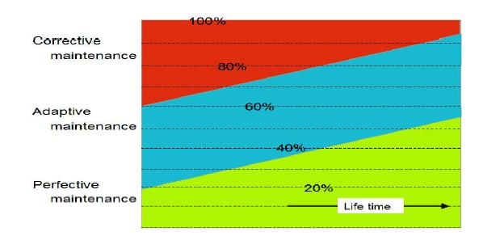

Unlike music and books, which stay unchanged over time, very little software doesn't change over time. It's quite likely that, as time goes by, software gains value.

Indeed, through continuous improvements, customizations, maintenance and new features, programs become more valuable to their users.

The mechanisms for calculating depreciation of tangibles and intangibles assume that goods lose value through use over time. However, well-maintained software in active use will tend to gain value.

## Continuous improvement

The key for software to keep gaining value lies in its continuous improvement, which translates into software maintenance. This maintenance has been classified into 3 categories:
	
  1. Corrective maintenance. A fundamental part of keeping customers happy is fixing bugs on time. If you don't respond quickly to these requests, it's very likely that they will look for alternatives, or that the software will stop being used.

	
  2. Adaptive maintenance. This has to do with the adjustments that must be made to software when its operating environment changes. For example, when a new browser or operating system appears. This kind of maintenance is also done when there are changes in legislation, new government regulations, new taxes, etc. A lot of administrative and business software counts periodic adaptation among its costs.

	
  3. Perfective maintenance. This includes performance improvements, to ensure scaling as demand grows. The goal of perfective maintenance is to make the software work better; in the process new functionality gets added, but not so much that it becomes a new product.

According to various studies, 10% of maintenance effort is spent fixing bugs, mainly in the early periods after the software goes live. Adaptive maintenance accounts for between 15% and 50% of the cost of software over its life cycle, and perfective maintenance represents around 50% of software costs on average.

## The value of maintenance

There is a rule that says: "The price of software for the same functionality is constant, even if it is improved." [1]

Indeed, if a software vendor decides to raise the price of its product without adding new features, it encourages imitators to appear. Whereas keeping the price low discourages new competitors from entering.

Still, the cost of maintaining software matters. It's worth noting that the cost of fixing errors is normally borne by the developer, while adaptive and perfective maintenance is normally borne by the users.

A software developer must treat maintenance costs as part of its business model. Without maintenance, the software's perceived value keeps dropping. To offset these costs, it's common to offer a maintenance service, through contracts that can amount to 15% of the initial cost of the software or of the value of the licenses.

In an upcoming article we'll see how we can put a value on software, but it's important to be clear on how to factor maintenance into the growth of software's intellectual property value.
