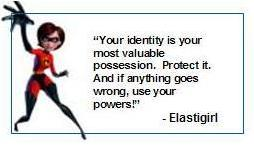

A few weeks ago I got in touch with [Kim Cameron](http://www.identityblog.com/?page_id=360) to ask him to authorize a translation of his [Laws of Identity](http://www.identityblog.com/?page_id=354). For those not familiar with the subject, Kim's work has been to research the problems of handling identity on the internet. I quote:

> "The Internet was built without a way to know who and what you are connecting to. This limits what we can do with it and exposes us to growing dangers. If we do nothing, we will face rapidly proliferating episodes of theft and deception that will cumulatively erode public trust in the Internet."

As an entrepreneur focused on developing [identity technologies ](http://www.biokey.cl/) Kim Cameron's work is important to me, but I think it is for all of us who are concerned about privacy and the use and abuse of personal information, both in commercial transactions and in other areas as diverse as freedom of expression and the protection of privacy.

For example, because of certain particular cases, the anonymity of comments is being [discussed in the blogosphere ](http://eldiabloenlosdetalles.net/2007/04/01/moderacion-de-comentarios-en-blogs/). The issue is complex, and as [Carlos](http://eldiabloenlosdetalles.net/) points out, in the end it's each person's decision. But there are spaces where anonymity is not desirable, since we want to protect ourselves from bad or unpleasant "elements". Following the analogy of the blog as something like our home, if a visitor shows up I'd like to know who it is, because if they commit an act of vandalism I'd like to be able to report them, and eventually, if they commit a crime, I can report them.

However, we also want a degree of privacy. Many of my commenters leave their email when they comment, because they trust that I won't misuse that information.

## Looking into the laws of identity

There is a line from ElastiGirl, in that wonderful movie The Incredibles, that goes:

> "Your identity is your most valuable possession. Protect it. And if anything goes wrong, use your powers."

Kim has used this image, very aptly in my opinion, to highlight the importance of this subject.

On this blog we will set out to explore the laws of identity, and we will translate Cameron's seminal work, which is probably one of the most important published in recent times.
