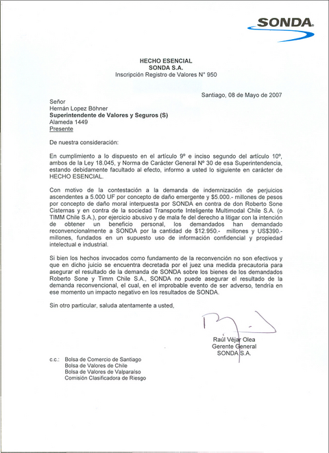

SONDA had to inform the Superintendencia de Valores y Seguros (Chile's securities regulator) by letter ([download the letter as a PDF](http://replay.web.archive.org/20071016204320/http://www.lnds.net/sonda.pdf)), as the law requires, about the status of its lawsuit against Roberto Sone and TIMM for 5,000 UF (Chile's inflation-indexed unit) in consequential damages and CLP 5 billion in moral damages.

This is the letter (obtained exclusively by LNDS ;):

As the letter states, Roberto Sone and TIMM have in turn countersued for CLP 12.95 billion and US$390 million, for use of confidential information and violation of intellectual and industrial property.

The [Economía y Negocios](http://replay.web.archive.org/20071016204320/http://www.economiaynegocios.cl/) site [has also published](http://replay.web.archive.org/20071016204320/http://www.economiaynegocios.cl/noticias/noticias.asp?id=26309) a speech by Andrés Navarro, chairman of Sonda, titled "Our truth about Transantiago: a lesson in resilience" ([download the speech as a PDF](http://replay.web.archive.org/20071016204320/http://www.lnds.net/Discurso_navarro.pdf)). I have copied the text below so it can be read in HTML.

(From here on these are the words of Mr. Andrés Navarro, chairman of Sonda)

## "Our truth about Transantiago: a lesson in resilience"

Speech by Andrés Navarro, chairman of Sonda

> Many of you have surely heard about the public questioning Sonda has faced over the last few months regarding our work on Transantiago. From the standpoint of communications, image and reputation, this is a situation that affects all of us. It affects the company and each one of us who are members of this organization. Wherever you go over the coming months, you will be challenged, questioned and often criticized about Transantiago and Sonda's work on the project. So it is very important to share the information we have, and to encourage one another, as well as to congratulate all the people who have worked on this project with unshakable enthusiasm.

### How does Sonda's story in Transantiago begin?

> Sonda's role in Transantiago begins with Sonda's acceptance, for which I take personal responsibility, of an invitation to become the technology operator of Transantiago, replacing the company that had won the tender, NEC, which was unable to deliver on its bid. So, belatedly, in the first quarter of 2005, we, who had come second in the tender, were given the opportunity to take on the role of Transantiago's technology operator, on the condition that we keep the price and the same economic terms offered by the winner of the tender. We accepted, but not before setting as a condition that Sonda would assume no responsibility whatsoever if the project failed because of political factors (since we knew that politically it was going to be a very complex project). The banks participating in the AFT then gave us a guarantee that if this project failed, ran into higher costs or collapsed for political reasons, they would return the money we had invested, with the corresponding adjustments.

> But we did keep responsibility for the technological risk; that is, if the systems we were going to develop did not work according to the specifications, we would assume the responsibility, which is duly defined and regulated in the respective contracts.

### Sonda's truth

> The launch of Transantiago was disastrous for many reasons. One of them is the mistake we made on that fateful Tuesday, February 13, of loading the wrong fares on some buses, which is why, as the AFT, we were forced to make the day free and absorb the cost of those free rides. It is important to stress that this particular mistake caused no disruption for the riding public, who traveled free that day. Nevertheless, the ministry still decided to punish us with four days of free rides, because they wanted to audit the operation of the Bip! card once again. At that point in the system's launch, it became evident to every observer that Transantiago, as originally designed, was insufficient to carry everyone. The Transantiago system, based on a network of trunk and feeder lines that makes it possible to match the supply of public transport with the demand, was designed for an average travel speed of 20 kilometers per hour (which required a certain number of exclusive, segregated lanes) and an average density per bus of six passengers per square meter. When the operation of the original design was checked against the reality of the city, it was plain to see that the original design was insufficient. So the ministry quickly asked for our help on several fronts. First, they wanted us to install validators on 500 more buses. However, since we already had every bus fitted with two validators each, we had to mutilate an equivalent number of buses (which were left with a single validator) in order to install validators on the 500 yellow buses that would be brought into the system. At the same time, a system was designed so that people could use the Bip! card on these "old" new buses, which were left with only a validator but no on-board computer. This means that the transactions accumulated in those validators have to be collected manually using mobile concentrators. The storage autonomy of the validators (about a month, or 60,000 transactions) allowed us to recover the transactions even though the buses often did not return to the terminals. Second, the ministry asked us to voluntarily take charge of implementing the prepaid zones, as a strategy to solve the problem of the crowds at the bus stops that climbed en masse through the doors of the buses and made it impossible for people to pay with their cards. For this, Sonda's professionals designed an ingenious system of portable battery-powered validators, self-sustaining in terms of energy. Today we have 50 prepaid zones in operation, with an average of four validators each. All of this means that the process of downloading transactions to feed the clearing has a significant manual component carried out during the night. The system is designed so that when the buses arrive at the terminals, which are equipped with a concentrator (a computer), they automatically download the transactions from their validators over a wireless link. However, all the transactions from the prepaid zones and from the buses that have no on-board computer, as well as those arriving at the most rustic terminals in the system (and there are quite a few), which in many cases do not even have electricity, must be loaded manually by our staff equipped with mobile concentrators, who night after night make the rounds of the various terminals across the city. A large contingent from Sonda has been doing this since February, with exhausting days and night shifts, with great effort and dedication to move the project forward, which implies tremendous human and economic costs for our staff and the company. The Bip! card is working perfectly; it operates and charges correctly. Out of the 35 million weekly transactions, about 800 complaints a week are received, which is absolutely within the permitted range. And not only does it charge correctly, it also integrates correctly. The integrated fare has to do with the fact that the computers track each passenger from origin to destination, see how many transfers they made and, based on that information, decide how much money goes to each of the actors in the system. The clearing, the processing of the transactions so that they are distributed into the boxes of each operator and the Metro, is a process that works well, but with a download system considerably slower than expected, because (for the reasons given, such as buses that do not spend the night at the terminals, and others) a lot of the transaction collection is done manually. That said, this delay has no impact on the payments to the operators, since they are paid every fifteen days, which allows us to maintain the robustness of the system with the three or four day lag we currently have. After the latest meetings we have put forward two alternatives: either they want us to fulfill the contract signed in 2005, under which we would have terminals with a Wi-Fi type system and concentrators for the automatic download of transactions, and deliver the clearing at three in the morning every day, or they want us to help Transantiago work under the current conditions. What is clear to us, and we believe the relevant authority has understood it this way, is that it is not possible to comply fully with the contract and also carry out the extraordinary requests they make of us. The reasonable answer, and we are sure that is what it will be, is the second alternative, since it is the only way for the system to settle and begin to work according to the initial expectations it was designed for. The third hypothetical accusation made against us has to do with the fleet management system, commonly referred to as the GPS issue. The truth is that the fleet operation support system is not working, but it is available to work. The reason that system is not working is that the operators have not loaded into it their routes and the checkpoints of each route, among other parameters. Nobody has loaded the data into the system. There are several reasons why this has not happened. For example, there are operators who do not want anyone to know how many buses they have on the street and, besides, since the ministry said at the beginning that this system was not going to work, they hold on to that view and do not load it, do not use it and do not pay for it either. In short, the system is available, and we have already gotten at least one operator to load its information into the software, and we are working with another so that they do it too and can use it. Transantiago is a project of great complexity because of the impact it has on the quality of life and habits of the citizens, and because of the large number of actors involved: the government takes part as the regulator, in addition to the nine public transport operators, plus the AFT, of which Sonda is a minority shareholder and technology provider. Unfortunately, governments never admit mistakes. This case is no exception. As a communications strategy, at first they tried to pin the system's failures on one of the system's operators. Then, since its chief executive resigned and they had no one to single out as the main culprit for the countless failures of the system, it was decided to point the finger at Sonda, its chairman and its top executives. As you know, the matter has gone beyond even the business sphere, reaching the point of personal slander, or ridiculous fabrications such as claiming that Sonda won the tender corruptly, and others not worth commenting on. We have been discredited as a company and as individuals. Our seriousness, and the prestige it has taken us more than 30 years to build, have been publicly called into question. Fortunately, investors and market analysts have not believed these fabrications and have continued to bet on and believe in Sonda's work, as shown by the fact that the shares have held a stable price during this period. We believe they know us better than we thought, and that the trust they placed in us is not based on a hunch or on something fleeting, but that they are clear about what our values are, what our experience is and how we approach our projects and, perhaps more importantly, how we face the difficulties that arise in those projects. I believe and hope that, as a result of the conversations and meetings we have had recently, this string of public attacks on our company and our role in the project is going to stop. I believe René Cortázar is well disposed to keep moving forward on resolving the pending problems, and that he is aware that there is no Transantiago without Sonda. A better understanding of the problem is beginning to take hold, along with a somewhat more impartial view of the responsibilities and the blame of each party. Sonda has done its job well. We are a systems integrator that has chosen good technology and has made an enormous effort, investing a significant amount of human and financial resources for the success of the project. We have also maintained an exemplary and prudent attitude in the face of the unjustified criticism and attacks we have been the target of, since we have not gone out publicly to blame others for our failures. We believe the time to look into who is to blame will come, and then we will be able to sit down calmly and see what the responsibilities of the actors are, and pay for them. But today we all have to work to move forward a project that we did not design, with tender terms and technical specifications that we did not draw up, of which we are mere implementers, but to which we have an unwavering commitment, the same one we make to each of our clients. Personally, I feel very proud of the whole team of engineers and technicians who have worked on this project. I am grateful for the commitment and effort we have put in day after day, without any recognition for our work, quite the opposite, reading every week columns by pundits, letters from users, editorials and press articles in which we are directly attacked and our professionalism and ability, and even our seriousness or honesty, are called into question. There is a modern virtue called resilience. It consists of people's capacity to overcome tragedies or periods of emotional pain, even coming out of those traumas stronger. To be in this business and take on projects as complex, challenging and even thankless as Transantiago, and to do it responsibly, with commitment and without giving up, takes a great deal of resilience. Sonda has an exceptional professional team, not because we are the smartest and the most capable, but because apart from those virtues, we complement and strengthen them with a great deal of resilience, diligence, effort, good will and humility. I am sure that Transantiago will be, in the end, a part of our history that will fill us with pride. In the meantime, I want to express my gratitude and all my encouragement to keep working with the same commitment and humility we have shown so far.

Here end the words of Andrés Navarro
