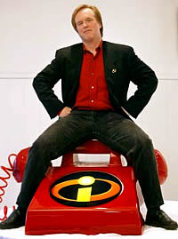
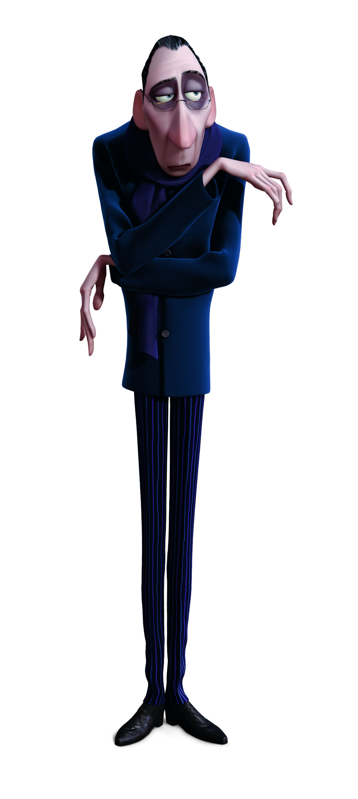
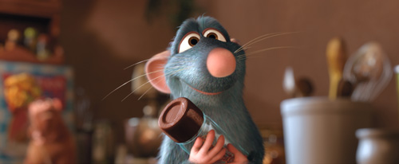

Rats was what we engineers call a **project on fire**.
It was an important film for Pixar, since it was the first
project of the "post-Disney" era, and so it had to have all the
makings of a hit. And although the work of Jan Pinkava, its
director, was of high artistic quality, Pixar's executives considered
the story "very flat."

Steve Jobs decided to do something. First he moved the release of Cars
from November 2005 to May 2006, and Pinkava's team was ordered
to strengthen the story and get the audience to care about
what happens to the characters.

Months later Pinkava showed his progress to Jobs and the board. The
characters and the setting were "adorable," but the story was still
weak. With the film as it stood, there was simply no way to
show that Pixar could live without Disney, let alone attract the
interest of the other studios.

If you know Steve Jobs, you know that he not only has good taste in
aesthetic and artistic details, he is also a man who knows
business, and knows how to push his teams to get the best
possible product.
The founder of Apple decided that something had to be done, fast.

**Call Mr. Incredible!**

Brad Bird had received his first Oscar and was wrapping up the promotion of
The Incredibles on DVD. A well-deserved vacation was waiting for him, but
he was asked to help the Rats people improve the story:

> \... Two weeks before I was set to leave, they asked me to help the
\'Ratatouille\' people fix up the storyline. So I did that for two weeks,
and I got them through the structure and about halfway through Act
Three. Then I waved goodbye and said, \'So long, and good luck,\' and
went on my vacation. I was away for two days when I got phone calls from
Steve Jobs, John Lasseter and Ed Catmull, basically asking me if I would
come back and take over the project."

Bird got 18 months to bring the project home.
Meanwhile Pixar was changing release dates and reaching an acquisition
deal with Disney, plus a seat on the board for Steve Jobs at
Mickey Mouse's studio.

## **Changes**

Several adjustments to the script were needed, along with a redesign of the
characters, to make them behave more like rats than like human
beings. Bird bought dozens of rats and brought them to the studio so
the animators could study them for months. Haute cuisine lessons and
trips to Paris were some of the activities planned to change
the look of the film.



Bird hired famous American comedians, and Peter O\'Toole
for the character of the food critic Anton Ego, probably one of
the best characters in the film.

The director cut many sequences involving Remy's family,
because the story is centered on Remy's desire to
become a chef, and so that was what it had to focus on.

Bird improved Colette's story, not only for the romantic angle;
he was also interested in the fact that French haute cuisine was still
an almost exclusively male domain, and with that he gave the character
more depth.

But what he most wanted to bring out was the physical comedy of the
film. There are ten minutes devoted to developing the curious
physical relationship between Remy and Alfredo Linguini, which manages to turn him into
the best chef in France.

## **Anyone can cook**

Like Anton Ego, I don't believe that anyone can be a great
artist, but I do believe that a great artist can come from
anywhere.

Talent is scarce, copying is very easy these days, and it seems that
anyone is capable of "creating" anything. Ideas like free
culture make us forget that we must defend creators.

On the other hand, thousands of pseudo-artists claim the right to be
protected and demand money from the State so they can devote themselves to producing
garbage labeled as art.

The government only promotes the culture it cares about, the kind that is not
dangerous or critical of its administration.

Everyone thinks that anyone can cook, and that injecting resources is enough
for the real artists to emerge.

But, as this film teaches us, cooking is more than mixing
ingredients.

## **Lessons**

Ratatouille teaches us that talent is not just something you are
born with; it has to be defended, and you also have to prove you have it.

On the other hand, from the production we learn that talent alone is not enough.
Jan Pinkava is a great Oscar-winning animator, but he didn't have all
the skills to carry out a project as important to his
company as this one.

A film, like a software product, is the fruit of
teamwork, and requires a committed, well-led team,
and a good script (a development plan).

Bird's films are not only brilliant and original, they are
full of lessons. Bird is a person who knows his talent and is
sure of it, but he recognizes the value of the team, of discipline and
rigor in bringing his projects to completion.

Remy rebels against the idea that the only thing a rat can do
is steal food. He wants to create, to invent new things. These days
it seems easier to steal ideas and copy them. The laziness is such
that we even end up copying ourselves (Shrek and
Dreamworks being a clear example).

We defend our right to copy, but we forget about the
rights of those who want to create.

Bird reaffirms my convictions: to create you don't need the protection of
an institution or of the state, but you must not stop defending your
right to create either.

## **A lesson for software engineers**

There is a sequence in this film that is shocking at first sight: dozens of
rats preparing food for a fearsome food critic. This is
perhaps one of the riskiest ideas in this animated film.

But in this sequence we see Bird reflected in Remy. The situation is
tense, the critic is waiting, the diners are getting impatient, and the
little chef directs his team with a single goal: to keep
his word and deliver a dinner worthy of the best chef in Paris.

That sequence shows how a major project should be run,
with fixed budgets and tight deadlines. It shows that despite the
rush, the details must not be neglected, that the chef must
care about the results and let his team do its work, while making sure
the salt is right and the seasoning is in just the right measure.

I not only recommend that you see Ratatouille, I invite you to learn
from Brad Bird's films. There is a lot to take from the stories of this
genius of animation, and his films can be enjoyed again and again.

---

References:

1.  [Jim Hill Media,, Why For did Disney struggle to come up with a
    marketing campaign for Pixar\'s latest picture ? Because the Mouse
    wasn\'t originally supposed to release
    "Ratatouille"](http://jimhillmedia.com/blogs/jim_hill/archive/2007/06/28/toon-thursday-why-did-disney-struggle-to-come-up-with-a-ratatouille-marketing-campaign-because-the-mouse-wasn-t-supposed-to-release-this-particular-pixar-film.aspx)

2.  [Steve Jobs\'s Sharp Turn
    with *Cars*](http://movies.aol.com/movie/ratatouille/25522/photos/ratatouille-anton-ego-is-a-dour-humorless-food-critic-whose-reviews-can-make/1889413)

3.  [Ratatouille Photos](http://movies.aol.com/movie/ratatouille/25522/photos/ratatouille-anton-ego-is-a-dour-humorless-food-critic-whose-reviews-can-make/1889413)
