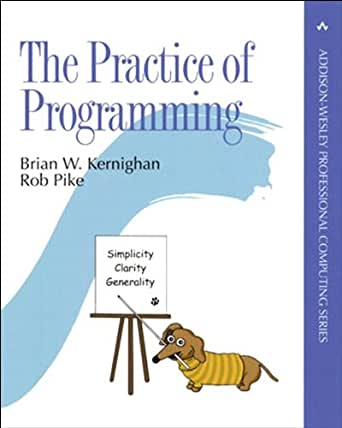

I once heard that [Knuth](/en/blog/lnds/2006/09/23/knuth-answers-all-questions/)
had this on his business card:

> "Donald Knuth - Programmer"

But over time he had to change it, because putting "Programmer"
as your "profession" on a business card was not well regarded.
These days my colleagues put anything on their business cards,
from Systems Analyst to Information Architect,
and of course Software Engineer along the way.

It seems that saying you are a programmer is something shameful, when
programming is the best thing a person can devote themselves to.

Recently [Enrique Dans wrote](http://www.libertaddigital.com/opiniones/opinion_38393.html):

> "The murky past has turned the profession of programmer into something
> that, apparently, few people want to practice. It has surrounded it with a
> black legend, almost with low social prestige, when in reality
> we are talking about the architects of the new economy, about a skill of
> high intellectual intensity that could be considered equivalent to
> mastering a language, a complex task that allows a person
> to interact and communicate directly with the machine. Being a programmer
> is a creative job, an indispensable role in today's economy
> that deserves a great deal of respect and generates high value. And
> yet, where are the programmers? Why aren't they coming out of the
> universities, ready to turn today's overabundance of
> ideas into code and take part in this revolution of creating
> so many activities on the net? What kind of professionals are
> computer science degrees and some engineering degrees producing, and why
> do they tend to reject the idea of programming as if it were a stigma or
> something typical of specialized laborers?"

Practice and discipline {#practicaydisciplina}
---------------------

Programming is what I like doing most. Not a day goes by without my
writing a few lines of code.

As Knuth believes, programming is an art, and as such it requires
**"practice and discipline"**.

That is probably why there are so few programmers, or why
young people don't want to be programmers: practice and discipline
are not very popular these days.

But there are problems in education too.

[Kernighan and Pike](http://cm.bell-labs.com/cm/cs/tpop/index.html) explain that the
practice of programming is made up of **simplicity, clarity and
generality**.

Many of the curricula for "computer engineers"
have everything except these three elements.

You can't convey simplicity if the foundation of the curriculum is Java, or
worse, object-oriented programming. The reason XML is
used for everything these days is that our engineers have been
trained to solve only the hard problems. They are not able to
tackle things step by step, or to split a big problem into small,
manageable ones.

I have had many young university graduates working for me, brilliant
kids, with good grades, and smart, but unable to
express themselves properly. What surprises me most is that they are
unable to communicate with users. They lack clarity in their
thinking, clarity in expressing themselves, clarity in what they deliver as
a final product.

A good programmer always thinks about what comes next, but doesn't go
crazy generalizing everything; he knows how to generalize what is really worth
generalizing. But training is lacking in design, in the use of
patterns, and in how to architect solutions.

Universities need to realize that what we need is not
Java programmers, but good programmers, professionals who have
discipline and practice, and who observe the pillars of the practice of
programming: simplicity, clarity and generality.
