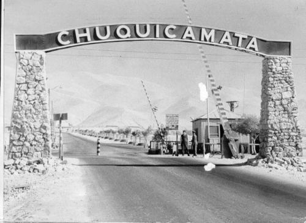
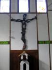

Dear Francisca:

My daughter, I was born last century, in a town that no longer exists.

How can I tell you the sorrow I feel right now?

The town where I was born, where my parents raised me, where my dad is buried, is gone.

You won't be able to see it. You never got to know it the way your older siblings and your mother did. Very little is left now, and since yesterday it has become a ghost town, like so many others in the north of our country.

It hurts, and I feel nostalgic. I now share and understand my grandfather's feelings, when he told me that he too had been born in a town buried under the mine's waste dump.

It is very hard to explain the glory days of that small mining city, which had everything, and was a jewel in the middle of the driest desert in the world.

It made me sad to see don Alcides Lira on television, the owner of La Verbena, an affectionate old man who more than once, when I was a kid, gave me wonderful presents, thanks to the enormous fondness he had for my father.
That gentleman, who [invited Santa Claus every year](http://www.angelfire.com/me3/ebellonorte/navidad/index.album/la-verbena?i=1), who would arrive on his sleigh, handing out candy, and settle on a stage that spanned the street in front of La Verbena, where we could receive our presents from his hands.
On that same stage where, as a teenager, I played the drums to help with the Teletón, Chile's annual charity telethon.

Further on was the Club Chuqui, where the old-timers played for the Copa Minera, and where my older cousins, along with hundreds of students on internships or on vacation, competed in the youth activities every summer. Outside the club was the "El Monje" newsstand, where my old man bought us El Billiken, and where my brother's love of comics began.

We idealize our memories, it's true. We had pollution; the climate and the landscape are harsh up there. The differences between payroll classes A, B and C were something that marked you, and the miners' struggles were just, and will never be understood by the rest of Chileans. But the people were like people everywhere, with their greatness and their pettiness. The miners never knew how to look after their income, and saving is something we never learned in that land of bad habits and needless spending.

Life goes on, and my life is with you now. You were born in Santiago and live there, and we don't know where life will take you, but I wanted to tell you this, my daughter, so you know where your father comes from. Maybe someday we'll visit the mine, and you'll get to see something of the historic town center, and we'll visit your grandfather's grave, which is the only thing left of my hometown.

_Goodbye, Chuquicamata, Incipit Vita Nuova...._

