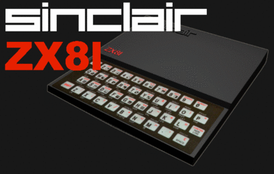

I've been programming for 26 years, and I identify completely with [Jeff Atwood's comment](http://replay.web.archive.org/20071017000912/http://www.codinghorror.com/blog/archives/000936.html):

> For many programmers, our introduction to programming was our dad forcing us to write our own games. Instead of the shiny new Atari 2600 game console I wanted, I got a Texas Instruments TI-99/4a computer instead. That's not exactly what I had in mind at the time, of course, but that fateful decision launched a career that spans thirty years.

In my case it was a Sinclair ZX81. I wanted an Atari console too, but in the end it helped me a lot.

While some of my friends plugged in a cartridge and played for hours, I had to type in programs from magazines before I could play. That's how I learned to program, almost by osmosis: modifying those magazine listings, experimenting, and then reading the articles that taught you BASIC, then assembler, and FORTH.

I remember that in eighth or ninth grade I visited the Codelco computing center in Chuquicamata. We were set loose on some imposing IBM 3670 terminals, and they let me play Twonky, a simple text game, which became the first game I ever programmed.

All of this led me to software engineering, and I can say with pride that I'm free to decide my own professional fate. I've never been short of work or of opportunities. Many of yesterday's proud Atari kids, sadly, can't say the same.

Today the OLPC XO is like the old Sinclair ZX81: a chance to shape developers and creators. The other options are like the Atari 2600: pretty, fun, but they don't build the skills needed to secure our children's future. "Don't give them a fish, teach them to fish," goes the old saying, and our country needs that urgently.

Among good programmers unemployment is nearly zero. The same can't be said of other professions and trades. We don't need people who know how to use Office, we need IT professionals. That will make us a richer country, and less dependent than we are now.

The recently created [presidential advisory council](http://replay.web.archive.org/20071017000912/http://www.emol.com/noticias/nacional/detalle/detallenoticias.asp?idnoticia=273013) has no programmers on it. It's a shame; we know a thing or two about creating wealth.
