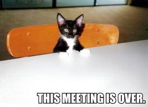
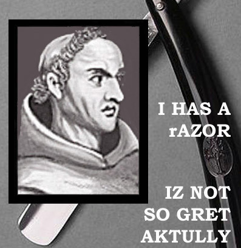

Eric Nakagawa was out of work when, last January, he came across
this photo, with a strange caption full of spelling and grammar
mistakes:

With a friend he started the site [I Can Has Cheesburger](http://replay.web.archive.org/20071017000912/http://icanhascheezburger.com/),
something like "can I have my cheeseburger?". Before long the
visits started coming, the lolcat phenomenon took off, and
Nakagawa had his new job.

Today his site gets more than 200,000 visits a day, and the advertising
revenue is "enough to pay all my bills,"
says the former programmer.

The idea is very simple: take a picture of a pet, preferably a
cat, and add a funny caption, written with little respect for the
rules of spelling.

Something that doesn't require being a Photoshop expert.

The phenomenon has spread to other fields, and there is already a craze for
[PhiLOLsophers](http://replay.web.archive.org/20071017000912/http://www.flickr.com/groups/philolsophers/pool/):

The term [LOL](https://es.wikipedia.org/wiki/Lol)
is an acronym for "laugh out loud".
