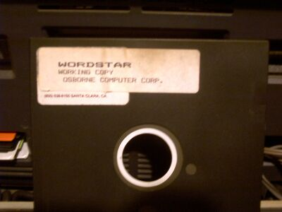

A [letter](http://replay.web.archive.org/20071017000912/http://www.elfrancotirador.cl/archivos/082707_dcc_responde_quepasa.pd) has been made public, sent by several faculty members of the [DCC](http://replay.web.archive.org/20071017000912/http://dcc.uchile.clde/), the computer science department at the Universidad de Chile, where I had [the privilege of studying](http://replay.web.archive.org/20071017000912/http://www.dcc8090.cl/).

The group of academics who signed it is a distinguished one, and the letter demolishes the argument of those who say that everyone complaining about the Microsoft-Government agreement is ignorant and doesn't know what they're talking about.

I support the intent of the letter, and I agree with it. What's more, the letter's appendix is very enlightening about the government's commitments. If I were Microsoft I would demand an explanation from the government, which commits itself and then says publicly that this agreement implies no commitment at all.

From now on businesspeople will have to be more alert when they sign commitments with the government....

But I'd like to make one clarification.

We can't accuse Microsoft of having always had a strategy aimed at preventing interoperability. To claim that is to ignore the history of the PC and of office software.

In the 80s I made my first few pesos teaching people to use [Wordstar](http://replay.web.archive.org/20071017000912/http://es.wikipedia.org/wiki/WordStar) and [DisplayWrite](http://replay.web.archive.org/20071017000912/http://en.wikipedia.org/wiki/IBM_DisplayWrite), one of the many word processors of that era, when PCs were called microprocessors.

Those were the days when I carried floppies in my backpack with my copies of Wordstar, WordPerfect and DisplayWrite. Nobody worried about interoperability, and honestly it was fun to use different programs.

The story of how Office became the dominant office suite has more to do with a shrewd business strategy, one that didn't require dirty tricks of the kind that are customary now. Microsoft watched its rivals destroy each other, and only had to avoid making the same mistakes.

The [Borland vs. Lotus case](http://replay.web.archive.org/20071017000912/http://en.wikipedia.org/wiki/Lotus_v._Borland) is a clear example of what I mean.

Times are different now. The fact that we're demanding interoperability is a good sign, but the reason we demand it is not fanaticism, nor that we consider Microsoft the root of all evil.

The reason we demand interoperability is that we need to guarantee the communication, the distribution and, above all, the "continuity over time" of our documents.

Today I can't read documents written in DisplayWrite because I have no access to that program. Not that I'm missing anything important, but imagine what would happen if tomorrow you couldn't read your Word documents because Microsoft has gone bankrupt (?!), has decided to discontinue the software, or simply because you can't pay for the license.

Which leads me to this thought: "more important than software being free, what really matters is that information is free."
