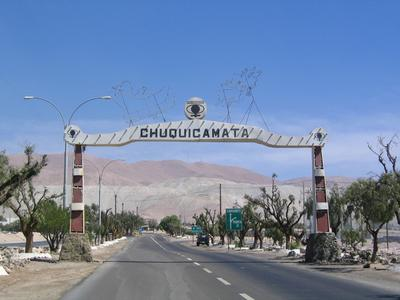
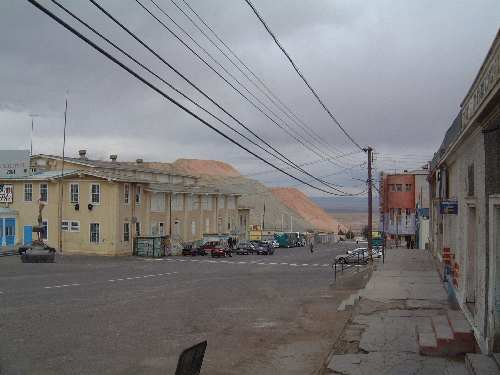
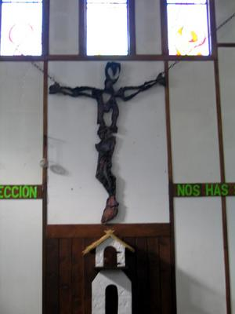

Dear Francisca:

My daughter, I was born last century, in a town that no longer exists.

How can I tell you the sorrow I feel right now?

The town where I was born, where my parents raised me, where my dad
is buried, is gone.

You won't get to see it. You didn't get to know it the way your older
brothers and your mother did. Very little is left, and as of yesterday it is a
ghost town, like so many others in the north of our country.

It hurts, and I feel nostalgic. I now share and understand the feelings of
my grandfather, when he told me that he too had been born in a town
buried under the waste rock dump.

It's very hard to explain the days of splendor of that small mining
city, which had everything, and was a jewel in the middle of the driest
desert in the world.

It made me sad to see on television don Alcides Lira, the owner of La
Verbena, an affectionate old man who more than once, when I was a kid, gave me
wonderful presents, thanks to the tremendous fondness he had for my father.

That gentleman, who [invited Santa Claus every year](http://replay.web.archive.org/20071016191218/http://www.angelfire.com/me3/ebellonorte/navidad/index.album/la-verbena?i=1),
who would arrive on his sleigh, handing out candy, and settle onto a
stage that spanned the street in front of La Verbena, where we could
receive our presents from his hands.\
On that same stage where, as a teenager, I played the drums to
help out with the Teletón, the national charity telethon.

Farther on was the Club Chuqui, where the old-timers fought for the Copa
Minera, and my older cousins, along with hundreds of students doing
internships or on vacation, competed in youth activities
every summer. Outside the club, the newsstand \"El Monje\", where my
old man bought us the Billiken magazine, and where my brother began his love affair with
comics.

We idealize our memories, it's true. We had pollution; the
climate and the landscape are harsh up there. The differences between the A, B and C
payrolls were something that marked you, and the miners' struggles were
just, and will never be understood by the rest of Chile. But the
people were like people anywhere, with their greatness and their pettiness. The miners never
knew how to look after their income, and saving is something we never learned
in that land of bad habits and frivolous spending.

Life goes on, and my life is with you now. You were born and live in
Santiago, and we don't know where life will take you, but I wanted to tell you
this, my daughter, so you know where your father comes from. Maybe someday
we'll visit the mine, and you'll see something of the historic center, and we'll visit
your grandfather's grave, which is all that remains of the town where I was born.

*Goodbye Chuquicamata, Incipit Vita Nuova\....*

