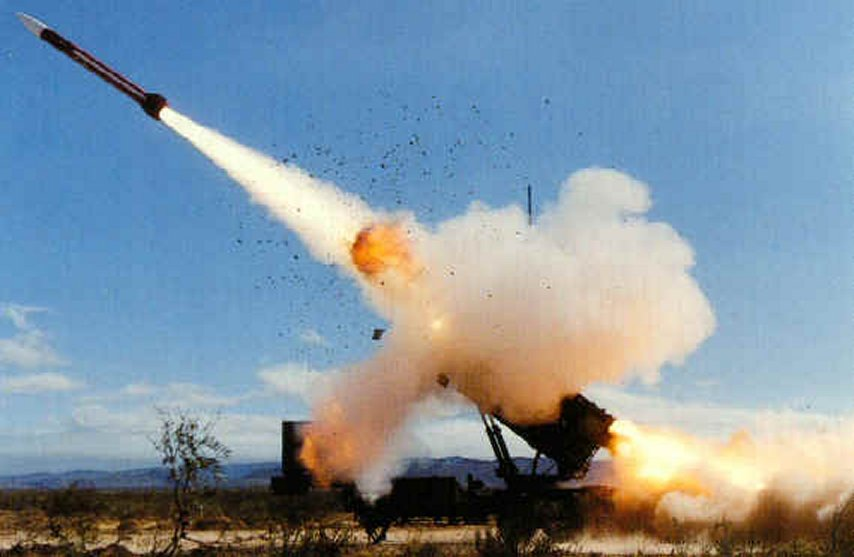

Although the Excel **2007** bug has gotten a lot of coverage, it is not the first rounding error in history, nor the most catastrophic. And although we don't yet know what consequences this new Excel bug may have, at least nobody has died from it so far.

But during the first Gulf War there was an error of similar origin that cost the lives of 28 American soldiers.

The Excel bug and the error that killed the soldiers have the same origin.

For those who haven't heard, the Excel **2007** bug is this: if you multiply 77.1 by 850, instead of getting 65,535 as you should, the cell shows the value 100,000.

The problem is not in the internal storage of the number, but in how the figure is displayed on screen. [Joel Spolsky explains the bug very well](http://www.joelonsoftware.com/items/2007/09/26b.html), and I suggest you read his piece for the details.

But, briefly, the binary representation of 77.1 is the following:

0100 0000 0101 0011 0100 0110 0110 0110
0110 0110 0110 0110 0110 0110 0110 0110

If you look closely, the sequence 0110 0110 0110 repeats. That's because 0.1 can't be represented exactly in binary notation. It's the same thing that happens in decimal when we want to represent 1/3, which comes out as 0.333333333333333.....

That is a repeating decimal, with infinitely many 3s "to the right". Well, the same thing happens with 0.1 in binary. That's why you have to be careful when working with floating point numbers.
Let's look at the tragic consequences of a bug of this kind.

On February 25, 1991, a Patriot missile battery in Dhahran, Saudi Arabia, failed to stop an Iraqi SCUD missile, which scored a direct hit on a barracks housing 28 soldiers.

From an [official report](http://www.fas.org/spp/starwars/gao/im92026.htm) we know that the Patriot missile failed because of an accumulated error in its internal clock. It turns out the software used a counter that was supposed to be incremented every 0.1 seconds for its calculations. The Patriot battery had been running for 100 hours, which accumulated an error of 0.34 seconds. Given that a SCUD travels at 1,676 meters per second, by the time the Patriot was launched it was already "off" by almost half a kilometer from its target.

The Excel **2007** error and the Patriot missile error are of the same class, a rounding problem, though of course the consequences are very different. Let's just hope nobody is using Excel **2007** to control some critical system, or one that human lives depend on.
