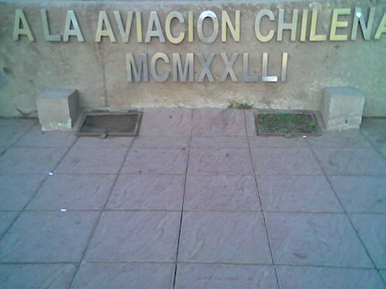
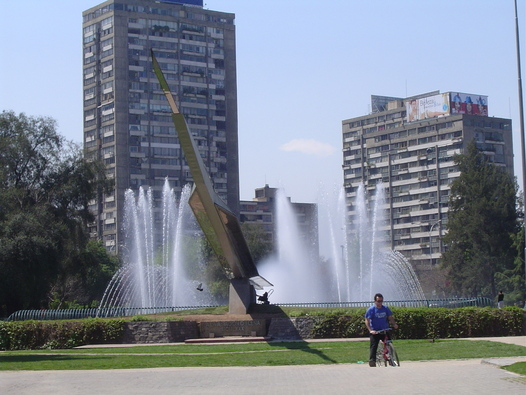

Can you tell me which Roman numeral they were trying to put at the foot of this monument?

The photo was taken by Hernán Cabrera, a fellow DCC classmate from the 80-90 crowd, on **December** 13, **2007**.

It's the [Monument to Aviation](http://www.viajeros.com/modules.php?name=Galeria&op=ver_foto&pid=35608) in Providencia. Yes, this one, which those of us from Santiago know quite well:

I say they were trying to write 1981.

UPDATE

I'm informed:

> "The monument to CHILEAN AVIATION, designed by René Orellana and Beatriz Silva, was inaugurated in 1980..." ... "... an extension of Parque Balmaceda, with which it is often confused. In this area we find the monument to aviation erected in 1980 by the then Commander in Chief of the Air Force, General Mathei, from which it got its name."

Therefore, by decree, MCMXXLLI = 1980. So there!

ANOTHER UPDATE

Via [roduar](http://twitter.com/roduar) I learn that on **December** 13 he ["had already posted"](http://www.duarte.cl/blog/index.php?id=50725) about this (with a different photo) on another blog.

Too much of a coincidence?

At this very moment we are torturing my informant so he'll tell me whether he [read it first on Rodrigo Duarte's blog](http://www.duarte.cl/blog/index.php?id=50747).
