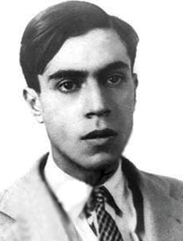
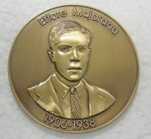

I heard about [Ettore Majorana](http://en.wikipedia.org/wiki/Ettore_Majorana) on the Chilean TV interview show [Una Belleza Nueva](http://www.unabellezanueva.org/), hosted by
Cristián Warnken.

At the end of the interesting [interview with the French physicist Etienne Klein](http://www.unabellezanueva.org/2007/?p=393), Warnken asks him to
comment on one of the characters described in his book: Il était 7
fois la révolution. That was when I first heard about
Majorana, and the mystery of his disappearance.

His story would make a plot for a novel (and it seems someone has already
written it). On the web I found [this interesting
account](http://www.geocities.com/Augusta/5130/majorana.htm) of
Majorana's mysterious disappearance. A true genius:
according to Enrico Fermi his intelligence was comparable to that of Newton or
Galileo.

Born in Sicily, Majorana was a precocious child, very fond of
mathematics. He was born in 1906, a year after the first publication
of Einstein's special theory of relativity. According to Klein,
Majorana is one of those young men who revolutionized physics, inspired
by Einstein's work.

In 1928 he joined the Institute of Theoretical Physics at the University of
Rome, under the direction of Enrico Fermi.

> The following year \[1929\] he received his doctorate with honors,
> but for the next five years he worked with Fermi solving
> problems in nuclear physics. Although Majorana's academic output
> amounts to barely nine papers published between 1928 and
> 1937, his work is still admired today by the scientific community. The
> papers reveal a meticulous knowledge of experimental data,
> a knack for simplifying problems, a sharp mind and an
> uncompromising perfectionism. His criticism of the work of
> others earned him the nickname "The Grand Inquisitor". But he was
> just as severe with himself, which might explain his slow pace
> and his scant academic output. At Fermi's urging,
> Majorana left Italy in 1933, on a grant from the National
> Research Council. In Leipzig, Germany, he met Werner Heisenberg,
> also a Nobel laureate. His later correspondence with Heisenberg
> reveals that Majorana found in him not only a scientific colleague, but
> also a close friend. Heisenberg urged the young Italian to
> publish more often, but he was reluctant. "

But in 1933 he returns from Germany, with severe gastric problems and
symptoms of exhaustion:

> "His attendance at the institute became irregular and then he shut himself up in
> his house: the promising young physicist became a hermit.
> For four years he cut himself off from his friends and stopped publishing. It was not
> until 1937 that Majorana returned to what could be called a
> "normal" life. That year, after a long silence, he published what
> would be his last scientific paper and applied for the chair of
> physics. In November, he was appointed professor of theoretical physics at the
> University of Naples. Unfortunately for Majorana's self-esteem,
> his classes in Naples were poorly attended. His students
> simply did not understand what he was trying to explain to them. On
> January 22, 1938, he asked his brother, with some desperation, to
> transfer all the money he had in Rome to a bank in Naples.
> In March he asked for a large sum from his professor's salary, which he had not
> touched since his appointment. With that sum and his passport, he boarded the
> boat on March 25 and disappeared forever. "

His whereabouts are a mystery, and nobody knows whether he killed himself. One of the two
letters he wrote before disappearing is addressed to his family:

> "I have only one wish: do not wear black for me. Should you
> wish \-- or have \-- to follow social custom, wear some other
> sign of mourning, but for no more than three days. After that, I should
> remain only in your memories and, if you are able to, forget me."

Why did he fall into this state of depression? Was he perhaps shaken by
Nazi Germany, and did he decide to flee so that his work would not be
used by the fascist government?

Years later the first intriguing clue to Majorana's fate
appears, a clue that involves a fellow Chilean:

> "In 1950, the Chilean physicist Carlos Rivera lived in Buenos Aires,
> the capital of Argentina, and stayed temporarily in the house of an
> elderly woman. By chance, the old woman came across the name Majorana
> among his papers, and told him that her son knew a man with
> that surname, but that he no longer worked in the field of physics,
> but in engineering. Rivera had to leave Buenos Aires and
> could not follow the lead. Curiously, Rivera came across Majorana's
> trail in Buenos Aires once more. In 1960, while dining in a
> restaurant, he was absent-mindedly writing mathematical formulas on a
> napkin. A waiter came over and said: "I know someone with the
> same habit of scribbling math on napkins. He comes here
> from time to time. His name is Ettore Majorana and he was a famous physicist in
> Italy before the war, when he left his country to come here.
> But this lead came to nothing as well: the waiter did not have Majorana's
> address, and once again Rivera had to leave before solving the
> mystery. "

The interesting thing is that, according to Klein, much of Majorana's
work was far ahead of its time. Apparently, in the 30s
he had solved problems that were rediscovered by the great physicist
Richard Feynman at the end of the 60s.

On Majorana's centenary, in 2006, the Electronic Journal
of Theoretical Physics established a prize in memory of the Sicilian
physicist.

The Majorana Medal is an annual prize for researchers who
show great creativity, critical sense and mathematical rigor in theoretical
physics.

Source: [Majorana, Escape to another world](http://www.geocities.com/Augusta/5130/majorana.htm).
