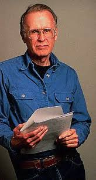

I learned Fortran at the Universidad de Chile, as a freshman. The course
was normally taught with Ratfor, and the following year they switched to
Pascal, but I, for reasons I can't remember, ended up with
Fortran.

Used to programming in Basic, I didn't find it hard to learn this
venerable programming language. Today [I read a
write-up](http://linuxandcomputerscience.blogspot.com/2007/12/50-aos-con-fortran.html)
that actually shows a Fortran far more modern than the one I
got, [Watfor-77](http://csg.uwaterloo.ca/sdtp/watfor.html).

Fortran is now turning 50, in the same year that its creator,
[John Backus](http://en.wikipedia.org/wiki/John_Backus), passed away.

Backus also invented Backus-Naur form, the notation used to
describe formal languages, programming languages in
particular.

I don't know how many programmers can say they have invented their own
programming language, but I have invented several, and in the 90s,
together with [Marco Zúñiga](http://blog.maz.cl/), we got as far as selling
licenses and teaching courses for a small programming language,
invented by him and later expanded by me. It was called **Sanscript**.

We worked with this language for at least 2 years, on various
telecommunications projects, and it had modest success in the local
industry. It had its own virtual machine, and it would be what people today
call a domain-specific language (DSL).

There was some Fortran in that mini language, so it may well be that without
Fortran there would have been no Sanscript, and no memorable moment
in my life either.
