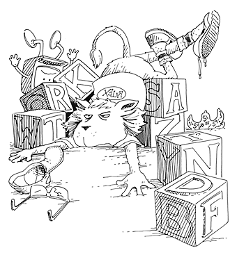
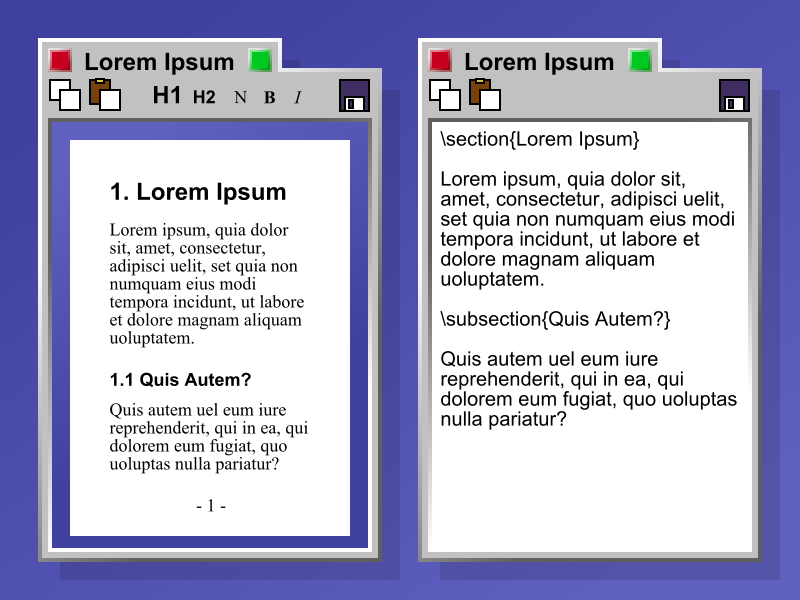

I find it funny when people rail against Microsoft from a [PC running Windows XP](http://www.elfrancotirador.cl/2008/01/14/ooxml-en-chile-la-delgada-linea-roja/#comment-56552). If Linux solves all their problems, why don't they install it?

There is a lot of posturing around free software, and also a lot of ignorance when people talk about technology.

A recent example of these ignorance-laden arguments is the one that proposes LaTeX as an alternative to the OOXML format.

Well, as a fan of [Knuth](http://sunburn.stanford.edu/~knuth/), and of [Leslie Lamport](http://research.microsoft.com/users/lamport/) too (above all for his work in distributed computing), I feel a certain duty to explain a bit of what this LaTeX thing is about and why it is not an alternative to OOXML, and while we're at it, to see if we can bring a little "culture" to the debate.

First, [LaTeX](http://www.latex-project.org/) is a set of macros and scripts that simplify typesetting text with a more general system called TeX, invented by our beloved Donald Knuth.

TeX stands for the Greek letters tau, epsilon and chi, and corresponds to the Greek root TeX, as in the Greek word tekné, which is the root of the word technology.

So TeX is more than a typesetting system. It is an expression of Knuth's philosophy about the relationship between art and technology.

It so happens that in the late 70s Donald Knuth was revising the second volume of his magnum opus, The Art of Computer Programming (colloquially known as TAOCP). Unhappy with the galley proofs, Knuth, a man with a deep aesthetic sense, thought it over and came to the conclusion that the art of digital typography consists of arranging 0's and 1's (ink and no ink) in the proper pattern. So he said to himself, "As a computer scientist, I really identify with patterns of 0's and 1's; I ought to be able to do something about this".

Knuth set out on a job that took about ten years, in which he got help from typography experts such as [Hermann Zapf](http://www.unostiposduros.com/paginas/maes22.html), the famous type designer.

The result of those years is the system known as [TeX](http://www.tug.org/whatis.html).

TeX is "intended for the creation of beautiful books—and especially for books that contain a lot of mathematics" (from the introduction to The TeXbook).

One of the interesting things about TeX is that its source code is not only free, it is beautifully written, since it was written using Web and Tangle, a language that lets you compose code that is pleasant to read, using a technique known as [Literate Programming](http://www.literateprogramming.com/).

Besides TeX, Knuth wrote MetaFONT, a system for specifying and creating fonts in bitmap format.

Knuth presented the foundations of his work to the AMS (American Mathematical Society)

  * The software was to be used directly by authors (and their secretaries), who are the ones who really know what they are writing about.
  * It came from an academic source, so it would be freely available, for no monetary fee (at the time nobody worried much about the matter of support).
  * The system would end up being available on any operating system and would be designed so that the input **files** would be portable.
  * And the system would not be [WYSIWYG](http://es.wikipedia.org/wiki/WYSIWYG).

In fact, that is one of the problems that WYSIWYG systems still have. For example, you can put a math formula into a Word document and find that the very same formula looks wrong somewhere else in the document. Let's not even talk about what happens with Word on Windows versus the Mac version.

In this creative process Knuth came up with one of the best abstractions in any computing system: the concepts of [Glue and Boxes](http://scienceblogs.com/goodmath/2008/01/the_genius_of_donald_knuth_typ.php), the central elements of composition in TeX. To program efficiently in TeX you have to master these two concepts, which together solve many (if not all) of the typographic problems that come up in professional publishing.

Knuth's work on TeX was not only revolutionary, it probably established the best typesetting system ever achieved.

In the early 80s Leslie Lamport [had ambitions similar to Knuth's](http://research.microsoft.com/users/lamport/pubs/pubs.html#latex): to write a mega work, the Great American Concurrency Book. And since Lamport was a TeX user, he decided to write a set of macros so he could write his book.

That is how LaTeX was born, a "document preparation system", as its author called it. The prefix La is simply its author's initials: LaTeX is literally Lamport's TeX.

I used LaTeX at work for years, and had fun programming my own macros as alternatives to the ones Lamport wrote. And I would still use it if I had to write documents frequently, but this system is really ideal for scientific publications. In fact, many journals require that submitted papers be in LaTeX.

In practice, though, Word is enough for writing letters or reports. But it is widely used in the academic world, probably because they have a lot more free time ;)

Be that as it may, the idea of LaTeX is to stop worrying about how a document is going to look and focus more on the content. The formatting is supplied by LaTeX, through a series of predefined templates.

For example, if I want to write an article I have to write the following:

  \documentclass[12pt]{article}  
  \usepackage{lingmacros}  
  \usepackage{tree-dvips}  
  \begin{document}  
  This is a document  
  \end{document}

The format in which this document will appear is not important to the LaTeX user. What the system guarantees is that it will always come out the same. If you didn't have a good monitor you could burn through quite a lot of paper running tests (something that doesn't seem to bother university people much either).

Although you can format anything with TeX, doing so is hard work. In the end you are "programming your text". That is fine in certain environments, like academia, but it is not practical for companies or the public sector.

Yes, there are tools that let you work visually with TeX or LaTeX, but they are not very flexible and their results aren't that satisfying either.

But you have to understand that TeX lets you compose the typography of a document. That is what it is designed for. It is not designed to interoperate in business environments.

Let's put it this way: you can create a document in TeX, and the output, the result of running TeX (or LaTeX) on your document, is another document in another format, which can be Postscript, PDF, HTML, Word, or something else. In fact, you can generate ODF **files** with LaTeX!

LaTeX is the language where you describe what you want to write. You care more about the content (if you care about typography you "drop down" to TeX).

ODF, on the other hand, is a format that not only holds the text but integrates with multiple sources, adds binary attachments such as images and sound, and lets you interoperate with other systems.

ODF formats text, just as LaTeX does, but it is the ability to interoperate with other systems that makes it different, and gives it its power (and its usefulness).

For example, you can insert a fragment of a spreadsheet into a presentation, or a slide into a text document, and even add a link to a movie, and all of it interacts dynamically. You can press a button and have the result of a formula in a spreadsheet change the entire text of a letter.

Another thing TeX wasn't designed for is electronic signatures. In fact, can somebody tell me which is correct: applying the electronic signature to the final output of a LaTeX document, or to the source? This problem is quite interesting in itself and would be enough to put together a whole standard, or a committee to evaluate it.

That kind of interoperability is what proprietary formats like those of Microsoft Office, or open formats like ODF, solve.

LaTeX is designed for preparing documents. TeX is designed for composing documents with beautiful typography.

ODF is something else. It is a format for transporting information, integrating multiple systems and multimedia technologies, and making office automation easier.

Besides, since ODF is an XML document, you can apply endless further transformations, which lets you automate thousands of processes.

No, LaTeX (and TeX), extraordinarily valuable systems that they are, are not suited to the needs of office work and document management. So it's best not to get confused about these things.

One last thing: if you need help with LaTeX, or with some macro for TeX or MetaFONT, well, don't ask me. I don't remember anymore.
