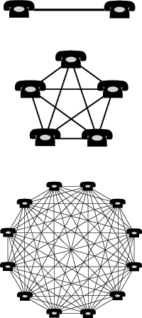

[Bob Metcalfe](http://www.ibiblio.org/pioneers/metcalfe.html) is one of my favorite entrepreneurs, and I think his ideas about how to start technology businesses are among the best I have read.
Metcalfe is one of the creators of [Ethernet](http://portal.acm.org/citation.cfm?id=358015), the technology used in local area networks. If your computer is connected to the network by a cable, it does so through an Ethernet card. That's how important this gentleman is.

Ethernet, also known as IEEE 802.3, is the standard that prevailed at the end of the 80s as the way to connect computers to a LAN. Few people today remember [Token Ring](http://en.wikipedia.org/wiki/Token_ring), for example, despite how ingenious its design was.

Of course, Robert Metcalfe has pulled some pretty embarrassing stunts, such as predicting the total collapse of the Internet in 1995. In the end Metcalfe had to eat his words ([literally](http://www.merit.edu/mail.archives/nanog/1997-04/msg00192.html)).

One of the famous terms coined by Metcalfe is the [Network Effect](http://en.wikipedia.org/wiki/Network_effect).

Essentially, what this concept says is that while the cost of a network is proportional to the number of nodes in it (N), the value of the network is proportional to the square of the number of nodes (N^2).

The network effect causes a good or service to have a value to a potential customer that depends on the number of other customers it has. In other words, the number of people who have already adopted a service is a factor in the value available to the next adopter.

One consequence is that an individual's purchase of a good indirectly benefits the others who already own that good. For example, when a person buys a telephone, it makes all the other telephones more useful (and therefore the telephone service becomes more valuable).

Microsoft Office is an example of how a product benefits from the network effect.

> For many people choosing an office suite, prime considerations include how valuable having learned that office suite will prove to potential employers, and how well the software interoperates with other users. That is, since learning to use an office suite takes many hours, they want to invest that time learning the office suite that will make them most attractive to potential employers (or consulting clients, etc), and they also want to be able to share documents.

> Similarly, finding already-trained employees is a big concern for employers when deciding which office suite to purchase or standardize on.

In the long run, this combination of factors means that an office suite like Office ends up controlling almost 100% of the market.

In fact, [the story](/en/blog/lnds/2007/08/28/commitments-clarifications-and-freedom-of-information/) of how we got to this situation, where Windows and Office are the monopoly, has to do with a skillful handling of the network effect.

But this kind of thing isn't understood. There are people who [still believe that people use Office because they are lazy or stupid](http://www.elfrancotirador.cl/2008/01/14/ooxml-en-chile-la-delgada-linea-roja#comment-56802). It isn't so. There is plenty of rationality and practical judgment behind the behavior and the adoption of this product.

When there is a network supporting a service or product, it becomes very hard for competitors to get in, or to create a new network that delivers the same benefits.

What value do I get from switching to ODF? I think that is the kind of question the people promoting it should be asking. This is not about wishful thinking, much less about insulting those who don't use it. A standard ends up being adopted because it is valuable, and the sense of value is something that doesn't necessarily have to do with quality (paradoxical as that sounds).

That is why [there are analysts](http://xml.sys-con.com/read/485296.htm) who hold that [despite the efforts of the users backing ODF](http://www.elfrancotirador.cl/2008/01/14/ooxml-en-chile-la-delgada-linea-roja), in the end **OOXML will prevail**. It is very hard to neutralize the network effect.

Although it is also predicted that this kind of format will fall into disuse with the adoption of W3C standards, the use of XML and CSS, and the adoption of applications distributed in "the cloud".

If you had to bet, would you put your chips on ODF?
