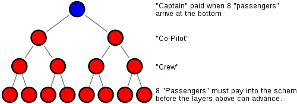

Today a coworker told me about the game of "la célula" (the cell), a pyramid scheme that is apparently spreading across the country from Concepción. It coincides with this [post](http://www.antiteoricos.cl/2008/01/16/por-que-no-jugar-a-la-celula/en) on the blog [Antiteóricos](http://www.antiteoricos.cl/), where they warn us about this scam.

Because **it is a scam**, even if they dress it up as a game. In fact it is a crime in many countries, such as the United States, Great Britain, Canada, Malaysia, Norway and several more, according to this [Wikipedia article](http://en.wikipedia.org/wiki/Pyramid_scheme).

The célula scheme is a game in which one person invites 7 more to form a cell. That person receives CLP 100,000 from the other members, and once the cell is complete it splits and every member of the cell starts a cell of their own.

It is estimated that this scam resurfaces every ten years or so, and in fact it is so old that this scheme is known to have existed in the Roman Empire! And in Albania the pyramids [nearly set off a civil war](http://www.cnn.com/WORLD/9701/27/albania/index.html#turmoil).

If you hear about offers to play la célula, please don't take part. I'm not sure whether this is a crime in Chile, but if memory serves, in my lifetime I have seen similar schemes run through our country at least twice, and as far as I recall they all ended very badly, some even with people going to jail for fraud, or at the very least with a lot of people losing money.

This system cannot sustain itself. In fact, it is known that the great majority of the people who take part in a pyramid scheme like la célula will lose their money. The diagram above shows that in a pyramid scheme everyone from the third level down loses their money. In fact, many of these schemes are known to be built by the first people who join them, who walk away with all the money while the rest are unable to sustain the base of the pyramid.

For those who want to learn more:

[La Trampa de las Celulas de Abundancia](http://celulasdelaabundancia.blogspot.com/), a Spanish blog that reports on this phenomenon in Spain.

[The easy road](http://celulaenconce.blogspot.com/2008/01/el-camino-facil.html)

[Why you shouldn't play la célula](http://www.antiteoricos.cl/2008/01/16/por-que-no-jugar-a-la-celula/).
