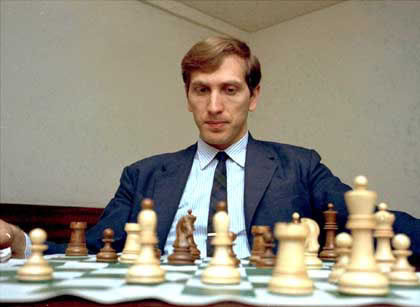
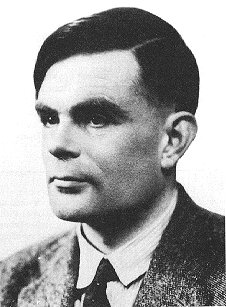
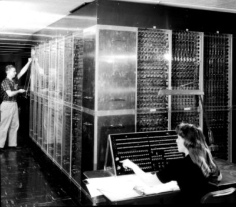

[Bobby Fischer](https://www.elmundo.es/elmundodeporte/2008/01/18/masdeporte/1200654941.html),
a chess legend, died today. An interesting figure, with a life that would make a
novel or a good movie.

Chess has become a completely solved problem
from the computational point of view. In 1997 Deep Blue defeated
Kasparov and proved that it is possible to build a machine that beats
the best player of this sport.

The history of chess played by a machine goes back a long way. Famous
is the story of the
[mechanical](/en/blog/lnds/2005/11/04/artificial-artificial-intelligence/)
[Turk](https://www.portalajedrez.com/anecdotas/turco.php), a
machine in the shape of a Turk that is said to have defeated even Napoleon
Bonaparte. In reality there was no mechanism at all: it was
operated from the inside by the Austrian chess champion Johann
Allgaier.

The interesting thing is that the great pioneers of computing have
taken part, at some point in their careers, in this challenge of
building a machine able to play chess as well as a human.

Alan Turing, the true father of computing; Claude Shannon,
creator of information theory; John von Neumann, the first
designer of the programmable computer and of the model behind almost all
modern computers; and Ken Thompson, the creator of UNIX. All of them
have played chess at another level, building programs or machines that
played chess.

## **Turing**

Alan Turing, at
the end of the Second World War, designed the instructions for a
machine able to play chess. Since there were no machines at the time
that could execute the instructions he wrote, he decided to act
as a "human CPU" himself, which took him about an
hour and a half per move. This "paper machine" of Turing's was tested,
and we have the record of one of its games, in which Turing's paper
machine loses to one of his colleagues:

> Chess game between Turing\'s paper machine and Alick
> Glennie, Manchester 1952:
>
> 1.e4 e5 2.Nc3 Nf6 3.d4 Bb4 4.Nf3 d6 5.Bd2 Nc6 6.d5 Nd4 7.h4 Bg4 8.a4
> Nxf3+ 9.gxf3 Bh5 10.Bb5+ c6 11.dxc6 0-0 12.cxb7 Rb8 13.Ba6 Qa5 14.Qe2
> Nd7 15.Rg1 Nc5 16.Rg5 Bg6 17.Bb5 Nxb7 18.0-0-0 Nc5 19.Bc6 Rfc8 20.Bd5
> Bxc3 21.Bxc3 Qxa4 22.Kd2? \[22.h5 could have trapped the bishop\]
> 22\...Ne6 23.Rg4 Nd4? \[23\...Rxb2! 24.Bxb2 Rxc2+\] 24.Qd3 Nb5 25.Bb3
> Qa6 26.Bc4 Bh5 27.Rg3 Qa4 28.Bxb5 Qxb5 29.Qxd6 Rd8 0-1.

## **Shannon**

Claude Shannon,
creator of information theory, analyzed the problem in 1950 and
considered two kinds of strategy, a brute-force one (Type A) and a
more selective one (Type B). Shannon considered Type B algorithms
to be more efficient, because they consume fewer resources and take less
time. Yet the best chess programs are Type A,
because in practice the problem of selecting the most plausible
moves at a given moment is a very hard one, and
advances in hardware have overcome some of the objections
about running time that Shannon raised in his study.

## **John von Neumann**

During the development of the atomic bomb, one of the hard
problems was calculating the correct shape for
the implosion charges that trigger the chain reaction. Building
a computer to do these calculations was entrusted
to John von Neumann.

In 1950 von Neumann's work took shape in a gigantic machine called
MANIAC I. Made up of thousands of vacuum tubes and relays, it could
execute 10,000 instructions per second and it was also programmable
(remember that the von Neumann model is the standard in almost all
modern computers).

Instead of getting to work on atomic bombs right away, the
scientists decided to put this machine to a more interesting use, and the
first thing they did was write a program that played chess. A
special kind of chess, mind you, where the board had 6×6 squares
and no bishops. With these restrictions the program could analyze
moves up to 4 levels deep, and it took about 12 minutes to
do so (had the bishops been included, the task would have taken
three hours).

Three games were played with this program in the mid 50s: the first
against itself, won by white; the second against
an expert player, which took 10 hours and which it finally lost; and the
third against a young woman volunteer (who had learned to play a
week earlier). In this case the human lost in under half an hour, and
we also have the record of that game (remember, it is a
6×6 board and there are no bishops):

> MANIAC 1 - Human, Los Alamos 1956: 1.d3 b4 2.Nf3 d4 3.b3 e4 4.Ne1 a4
> 5.bxa4? \[5.Nd2 and 6.Nd2-c4+ Nbcxc4 7.b3xc4 with a good game\]
> 5\...Nxa4 6.Kd2? Nc3 7.Nxc3 bxc3+ 8.Kd1 f4 9.a3 Rb6 10.a4 Ra6 11.a5
> Kd5 12.Qa3 Qb5 13.Qa2+ Ke5 14.Rb1 Rxa5 15.Rxb5 Rxa2 16.Rb1 \[to
> prevent 16\...Ra1 mate!\] 16\...Ra5 17.f3 Ra4 18.fxe4 c4 19.Nf3+ Kd6
> 20.e5+ Kd5 21.exf6Q Nc5 22.Qf6xd4+ Kc6 23.Nf3-e5 mate.

This game marks the first time a computer defeated
a human.

## **Ken Thompson**

The last computing
pioneer to take part in this race to develop a machine
able to defeat human beings is Ken Thompson, who together with Dennis
Ritchie created the UNIX operating system.

In the early 80s Thompson and some colleagues at Bell Labs
built a machine designed specifically to play chess. In
fact, it was the first machine to reach master level, in 1983.

This machine, affectionately called Belle, cost about 20,000 dollars and
could analyze 180,000 positions per second (the
supercomputers of the day could only manage 5,000 positions).

It was so powerful that it was confiscated by the US Department
of Defense when the team tried to take it to a tournament in the
Soviet Union in 1982.

Belle was the unbeatable champion of almost every computer
tournament between 1980 and 1983, until it was defeated by the
Cray X-MP supercomputer, which cost a thousand times more.

Sources:

-   [A short history of computer chess](https://www.chessbase.com/columns/column.asp?pid=102)
-   [KEN, UNIX, AND GAMES](https://cm.bell-labs.com/cm/cs/who/dmr/ken-games.html)
