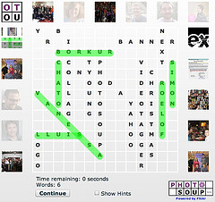

[Carlos ChaTo Castillo](http://www.chato.cl/blog/) tells us:

> Once every few months, Yahoo! holds a "Hack Day", a day when any team of Yahoo!s can submit a "hack", a simple program that uses Yahoo! technologies or data, to a worldwide or regional competition. PhotoSoup was our Barcelona team's entry last year for the European Hack Day, and we won the "coolest hack" award ;-)

[Carlos](http://www.chato.cl/blog/) is Chilean, studied at the engineering school of the Universidad de Chile (where else?) and currently works at Yahoo Barcelona. You probably remember him for his site [tejedores de la web](http://www.tejedoresdelweb.com/307/channel.html), and he is a founding partner and technology director at [Newtenberg](http://www.newtenberg.com/1765/article-68140.html).

Congratulations to Carlos, and the great thing is that [PhotoSoup](http://next.yahoo.net/photosoup/es) is a game you can add to your own pages through the embed option. [Here is an example](/en/blog/lnds/2008/01/26/alphabet-soup-or-photo-soup/) I put together for this site (you can also click on the image that goes with this post).

The game is available as a beta, it is called [PhotoSoup](http://next.yahoo.net/photosoup/), and it uses the Flickr APIs. On the game's site you can create your own puzzles and embed them in your pages.

Enjoy.
