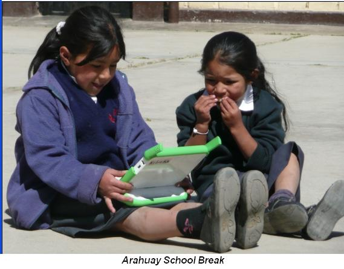

[via El Comercio](http://www.elcomercio.com.pe/ediciononline/HTML/2008-02-29/laptops-escolares-peruanos-distribuiran-partir-10-marzo.html)

> Thirty schools in the department of Huancavelica will be the first to benefit from the ambitious One Laptop per Child program, which gets under way on March 10, when a first batch of 2,200 laptops starts its journey to that region.

> The machines will be taken to the local education management units (UGEL) located in the provinces or districts of the 24 departments selected for the first stage. "The laptops will be handed to the schoolchildren through the teachers of the 569 rural schools that benefit," said Óscar Becerra, director general of Educational Technologies at the Ministry of Education.

> Becerra also said that the whole logistics process of registering, packing and distributing the first 40,000 machines (25,000 arrived in Lima by air last Tuesday and the remaining 15,000 are due on March 24) will take about 45 days.

> The laptops will be sent to rural multigrade, single-teacher schools in 146 provinces across the country's 24 departments. The machines will be activated at each school, a job that falls to the teacher in charge.

> The computers will reach each province or district in the boxes they left China in. For places with no electricity, a solar charger will be sent for every five machines. "If a school has more than 30 laptops, it will get a small generator," Becerra added.

This video is a report on the pilot carried out in Peru ([I hope Didier de Saint Pierre watches it](/en/blog/lnds/2008/02/26/chile-a-curious-and-shy-country/)):

You can also read [these notes by Ivan Krstic](http://radian.org/notebook/occupational-hazards) on his trek through Peru getting everything ready for this landing.
