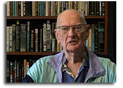
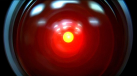
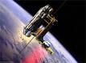

> "Any sufficiently advanced technology is indistinguishable from magic"

Arthur Clarke, the last of the "Big Three"[^1], died today at 90 in Sri Lanka, where he had made his home many years ago.

Besides being a science fiction writer and futurist, Arthur Clarke was an inventor and one of the main champions of the geostationary satellite. In fact, the orbit of a geostationary satellite is called the "Clarke Orbit".

## **2001**

Many people know Clarke from his work with director Stanley Kubrick on the film 2001, based on a Clarke short story: The Sentinel.

Although my favorite Clarke novel is "Childhood's End", I admit that 2001 and his collaboration with Kubrick (which had its share of problems) is impressive, and it produced one of the most powerful images science fiction has ever created. That is a movie worth watching several times. Clarke's influence is remarkable; one example is that memorable scene in which HAL is shut down.

## **The space elevator**

Another remarkable idea promoted by Clarke (though already sketched out by the great [Konstantin Tsiolkovsky](http://en.wikipedia.org/wiki/Konstantin_Tsiolkovsky)) is the concept of the [space elevator](/en/blog/lnds/2005/08/22/they-are-starting-to-stop-laughing/). As he once said:

> "The space elevator will be built 50 years after everyone stops laughing"

As with several of his ideas, besides contributing some scientific work on each concept, Clarke would write a novel on the subject, and in the case of the space elevator that novel is _"The Fountains of Paradise"_.

## **Clarke's laws**

Over his long career as an essayist and science popularizer, Sir Arthur Clarke coined several famous phrases, three of which have been singled out as "Clarke's Laws" and are quoted by all sorts of authors. Clarke's laws are:

> 1. When a distinguished but elderly scientist states that something is possible, he is almost certainly right. When he states that something is impossible, he is very probably wrong.

> 2. The only way of discovering the limits of the possible is to venture a little way past them into the impossible.

> 3. Any sufficiently advanced technology is indistinguishable from magic

Clarke has set out on his own "Rendezvous with Rama", and the world has lost a mind full of imagination and faith in the future of humanity. Maybe it is time to reread his books, and if you have never read anything by Clarke, maybe this is the right moment to get to know him. I invite you to read him.

[^1]: The Big Three of science fiction: Isaac Asimov, Robert Heinlein, Arthur Clarke
