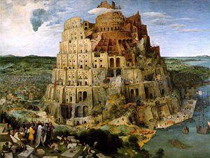

This whole OOXML episode [is not a drama](http://blog.maz.cl/2008/03/ooxml-antes-durante-y-despus.html). It is
actually a comedy, because the absurd is one of the springs that
feed comedy, and sometimes very funny things come out of the absurd.

The recent [comment by Juque](http://www.juque.cl/weblog/2008/03/27/liuba-dombrovskaia-no-sabe-de-estandares.html)
leads to an absurdity, though I suspect its author did not mean it to,
because either he does not understand the moral of the Tower of Babel myth, or he
has come up with a bad argument for criticizing [the sad position of Liuba
Dombrovskaia](http://eldiabloenlosdetalles.net/2008/03/27/citas-y-contracitas/).

It is not that I want to defend Mrs. Dombrovskaia, I have no interest in that.
It is just that when the rational arguments run out and people
have to turn to divine help or biblical inspiration, the thing
starts to smell bad (a rancid smell, actually).

This argument baffles me, because the moral of the story is
spelled out in Juque's own blog: God does not want humanity
to have a single language because that goes against his plan, namely: *\"that
humanity should spread over the whole surface of the Earth,
multiply on it and subdue it\"*.

To clear up any doubts, let's see what the Bible says.

**The Tower of Babel**

Genesis, chapter 11:
([source](http://es.catholic.net/biblioteca/libro.phtml?consecutivo=231&capitulo=3027))

1.  The whole world spoke the same language and used the same
    words.
2.  And when men migrated from the East, they found a
    plain in the region of Shinar and settled there.
3.  Then they said to one another: \"Come! Let us make bricks and
    bake them in the fire\". And they used bricks instead of
    stone, and asphalt served them as mortar.
4.  Then they said: \"Let us build a city, and also a tower whose
    top reaches to heaven, to perpetuate our name and not
    be scattered over the whole earth\".
5.  But the Lord came down to see the city and the tower that men
    were building,
6.  and he said: \"If this is the first thing they do, nothing they
    set out to do will be impossible for them, as long as they are one
    people and all speak the same language.
7.  Let us go down, then, and once there, let us confuse their language, so that
    they no longer understand one another\".
8.  So the Lord scattered them from that place, spreading them over the whole
    earth, and they stopped building the city.
9.  That is why it was called Babel: there, indeed, the Lord confused the
    language of men and scattered them over the whole earth

In other words, God does not want standards. On the contrary, he wants to create confusion,
because the existence of this standard meant a lot of power for
humanity.\
That is why he creates confusion (that is what the word means),
to scatter them. God does not like this business of humanity having a
single communication standard.

Well, the surprises you run into. I do not understand why
Microsoft wants to twist the will of God by trying to standardize
its products. I think that proves this company is ruled\
by the Devil.

This standards business is the work of the devil\...
