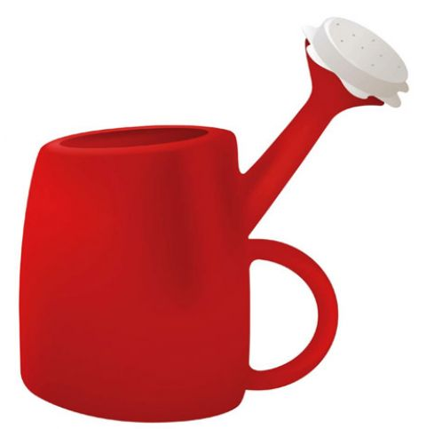
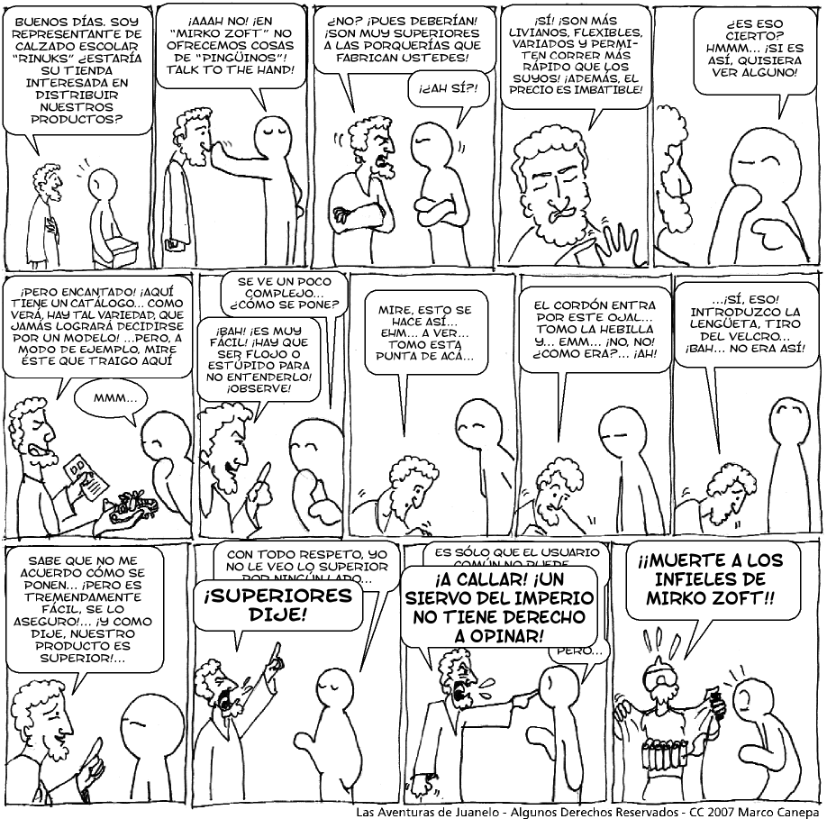

I installed my first Linux distro in 1993. I do not remember the details very well, but one of my friends who still worked at the DCC (the University of Chile's computer science department) handed me some floppies with Linux so I could install it on my PC. After installing and configuring it properly, the first thing I did was get and install X. Apart from running Xeyes, my goal was to emulate the multi-window environment of the Sun workstations I used at the university. In the end, all I wanted was multiple instances of Xterm.

Today I asked my daughter why she does not switch the operating system on her old PC to Linux. I was thinking of [Ubuntu](http://www.ubuntu.org/), of course (probably [XUbuntu](http://www.xubuntu.org/para), to get more out of that PC's limited hardware). After discussing it for a few minutes it became clear to me that Ubuntu does not meet my daughter's needs, not yet. And looks are no small part of it, something several Linux distros tend to forget.

**It's not about quality it's about freedom**

We know that for Stallman freedom is what matters most. On the other hand, some users have said that freedom is not the most important thing: [freedom is a plus](http://www.elfrancotirador.cl/2008/03/20/rompiendo-la-maldicion-del-pinguino/), [Christian](http://www.elfrancotirador.cl/) tells us.

I think that when Stallman talks about users he is not thinking of what we normally mean by the word. In his shaggy head the ordinary, everyday user is a hacker. But it has also been a long time since Stallman did any serious development, and anyone who has used Emacs will notice that usability is not among his priorities.

No more excuses!

Many free software developers today make a living from it, _from writing free software_. For example, 75% of the developers who contributed to version 2.6 of the Linux kernel [were paid a salary to work exclusively on that](http://lwn.net/Articles/222773/), and since a percentage of the developers are of unknown origin, the speculation is that the figure could be as high as 85%.

Gnome is backed by Novell, and MySQL, well, it is a company in its own right, and it has been absorbed by SUN precisely to grow its market share and strengthen it as a product.

**Usability matters.**

Free software is not an amateur affair. It is not built by long-haired types, hippies, or developers with a lot of free time on their hands. Free software is funded, and it has become an economically self-sustaining business.

So it is fair to ask that the focus be on the quality of the product for the end user. It matters, and not just the looks: more importantly, usability has become a priority.

We cannot accept the excuse that "you have to take free software as it is, because after all it is built by good-natured volunteers". That is no longer true.

Unfortunately, when these things are discussed, instead of offering us a solution, or sitting down to write a patch or an improvement, Linux hackers take an extremist stance that builds nothing. I think it is typical of the recent-convert phenomenon. Something that was captured very well in this [Juanelo comic strip](http://juaneloonline.blogspot.com/2007/03/las-aventuras-de-juanelo-346.html):

Now then, quality does not have to be sacrificed for freedom. That is another unacceptable fallacy.  
Freedom is not a plus, but it is not an excuse to justify a mediocre product either.
