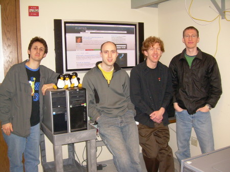

Recently [Port 25](http://port25.technet.com/), the website of Microsoft's open source community (yes, there are people at Microsoft who work with the open source world), published [photos of their labs](http://port25.technet.com/archive/2008/03/20/inside-the-oss-lab.aspx).

For those who did not know about this, here are several interesting details about these OSS Labs.  
1.- The OSS labs were created several years ago to work on interoperability.  
2.- The people working in these labs come from the FLOSS world, and their job is to evangelize inside Microsoft about how open source operates or works. (Officially, Microsoft always says open source, not free software. I think it is to stay out of trouble with Ballmer.)  
3.- Lately they have worked with Mozilla, Apache, Eclipse and PHP (Zend), providing access to internal information and technical support, and taking part in joint seminars.

Here are a couple of photos, and though [my namesake may not believe it](http://twitter.com/eduardoe/statuses/778293789), it is nice to see Tux in Microsoft's offices:

