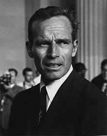
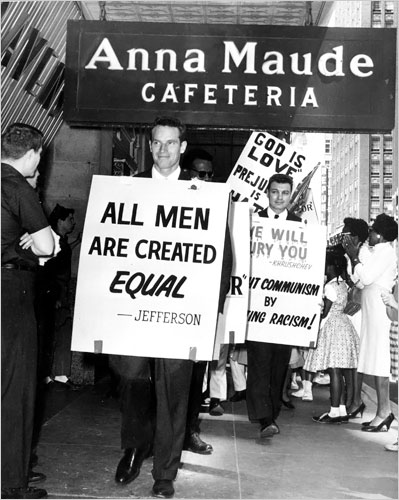

> "Soylent Green is people!"

For many people [Charlton Heston](http://en.wikipedia.org/wiki/Charlton_heston) is probably synonymous with epic or biblical movies (Ben-Hur, The Ten Commandments).

For others he is a stubborn old reactionary who refuses to keep talking to Michael Moore in a famous documentary. That image may be somewhat unfair, and incomplete, since Heston was a civil rights activist in the 60s, an opponent of the Vietnam War, and a supporter of gun control after the assassination of Robert Kennedy, although in the end he switched his affiliation from Democrat to Republican, probably as a consequence of his defense of the right to bear arms. As always, we cannot judge a person by just one of the things they did in life.  
They say Marilyn Manson thought Moore went too far, and that he had needlessly demonized Heston with the interview that appears in [Bowling for Columbine](http://en.wikipedia.org/wiki/Bowling_for_Columbine).

For me it was sad to watch that interview, because Heston was the hero of many of my favorite science fiction movies, like [Planet of the Apes](http://en.wikipedia.org/wiki/Planet_of_the_Apes_%281968_film%29), [The Omega Man](http://en.wikipedia.org/wiki/The_Omega_Man), and of course [Soylent Green](http://en.wikipedia.org/wiki/Soylent_Green).

About that last movie, known in Spanish as [Cuando el destino nos alcance](http://es.wikipedia.org/wiki/Cuando_el_destino_nos_alcance), I suggest you watch it when you get the chance: an interesting dystopia, with many allegories that I think still hold up.

Charlton Heston died this Saturday, April 5, 2008, at the age of 84.
