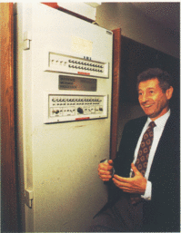

This photograph shows Leonard Kleinrock next to IMP1,
the Interface Message Processor, one of the packet switching nodes used
in ARPANET, the predecessor of the Internet.

> "The story goes that little Len Kleinrock got hold of a Superman
> comic book, in which he found instructions for
> building a "crystal radio". All the boy needed was
> one of his dad's used razor blades, a bit of graphite (from a pencil),
> an empty toilet paper roll and some wire, all of which was already
> at home. He even managed to get some old headphones, but he was missing a
> "variable capacitor". To get one he talked his mother into
> traveling to downtown Manhattan, to a radio and electronics store.
>
> When they got to the store, a very confident boy, 6 years old!,
> walked up to the counter and asked for a variable capacitor, to
> which the clerk replied with an unexpected question: "what
> size do you want?" The boy had to confess that he had no idea;
> in fact, he had never seen one of these parts. After
> he explained to the salesman what he wanted it for, they sold him what
> he needed. Kleinrock built his crystal radio, and was
> completely fascinated when he heard music coming out of his
> headphones, with no batteries, no need for power, all totally
> free. An engineer had been born.".

[Leonard Kleinrock](http://www.lk.cs.ucla.edu/) laid the theoretical
foundations of [packet
switching](http://en.wikipedia.org/wiki/Packet_switching), that is, the
foundations of several network communication protocols, and of the internet,
in his doctoral thesis at MIT: [Information Flow in Large Communication
Nets](http://www.lk.cs.ucla.edu/LK/Bib/REPORT/PhD/proposal.html), in
1961, and later his book "Communication Nets" convinced
many people that the ARPANET project was viable.

Since Kleinrock was working at UCLA in 1969, it was decided, given his great
contribution, that the first ARPANET node would be in
Kleinrock's lab at UCLA. On October 29, 1969, Kleinrock's
lab established the first link with Douglas
Engelbart's lab at SRI (Stanford Research Institute). That day
what would become the internet was born, and Kleinrock's theories were shown
to work.

I am grateful to Kleinrock's parents, who encouraged and supported his
curiosity and inventiveness as a child. How much of today's infrastructure
do we owe to that subway ride to downtown Manhattan, and to a page from
a comic book?
