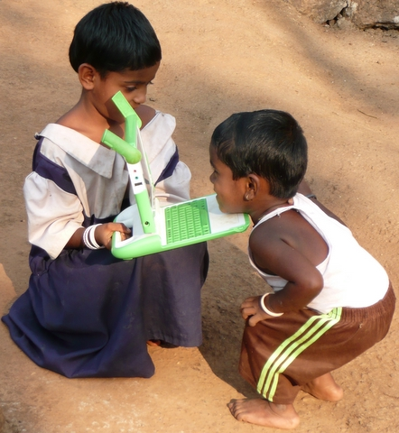
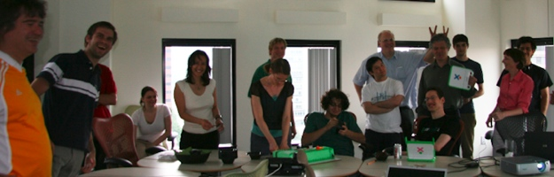

Richard Stallman has [decided to adopt an XO laptop](http://www.fsf.org/blogs/rms/can-we-rescue-olpc-from-windows) and move to it as his permanent work platform, because apparently the XO is the only laptop that runs a BIOS based on free software.

But Stallman writes about [the controversies](http://wiki.laptop.org/go/Controversies) that have arisen inside OLPC after Negroponte said that OLPC has failed because it used open source software. What's more, he has criticized a supposedly fundamentalist stance among the open source advocates inside OLPC.

This attitude of Negroponte's caused rifts and major [losses for OLPC](/en/blog/lnds/2008/04/23/olpcs-losses/). Negroponte's criticism points not only at this supposed fundamentalism, but also at the lack of an architect to guide the development of the Sugar interface in a more organic way.

Finally, Negroponte has tried to impose Windows XP support on OLPC's laptops.

**Things to remember when reading news about OLPC**

The people who left have reacted to Negroponte's criticism, and on this lack of an architect Ivan Krstic answers him in an interesting post titled [This too shall pass, or: Things to remember when reading news about OLPC](http://radian.org/notebook/this-too-shall-pass).

Krstic informs/reminds us that:

The SD card was not added to support Windows, but as a side effect of the work of Mark Foster, hardware architect, whose new chip made it possible to add the camera and an SD slot:

> _"The SD card slot didn't get added to the XO for Microsoft, as he is fond of saying, but because we were getting terrible read/write performance with our solid-state storage. Hardware architect Mark Foster designed a dedicated chip to speed things up; that chip, as an unanticipated bonus, made it easy to attach a camera and an SD slot.   
e. Hardware architect Mark Foster designed a dedicated chip to speed things up; that chip, as an unanticipated bonus, made it easy to attach a camera and an SD slot."_

Negroponte says Sugar has developed amorphously for lack of an architect. Krstic tells us that OLPC made him a written offer to take over as chief software architect, but Negroponte rescinded the offer unilaterally, without giving reasons. So if there is no architect, that is also the fault of OLPC's chairman.

> _"Nicholas' recent claim of Sugar growing amorphously because it "didn't have a software architect who did it in a crisp way" is similarly muddy: convincing him of the need for an architect is a battle Walter and I fought for months without success. The organization decided to move anyway, and extended me a written offer to take over as Chief Software Architect. Nicholas rescinded the offer unilaterally several weeks later, for reasons he refused to explain to anyone. So yes, there was no architect, but that's because Nicholas didn't want one. If he believes that's the cause of Sugar's problems, he has no one but himself to blame."_

**It's an education project**

Stallman has put very well the fact that OLPC runs the risk of becoming irrelevant:

> _[OLPC] It is also superfluous. The OLPC has already inspired other cheap computers; if the goal is only to make cheap computers available, the OLPC project has succeeded whether or not more XOs are built. So why build more XOs? Delivering freedom would be a good reason._

That worries Negroponte, and he thinks, mistakenly, that it is all about getting laptops to as many children as possible, and that once that is done, OLPC's goal is met.

That is also the mission of the Chilean project, [UCPN](http://www.ucpn.cl/): that children have access to a personal computer.

I do not think that is the idea. There are already cheap computers that would make this goal achievable, and these days it would not cost the Chilean state all that much.

I think the greatest value lies, as always, in the software.

Walter Bender and many who support him think the same, which is why he has set up a mailing list to define the future of Sugar. Since it is available under a free license (GPL), it makes sense to build a community focused on developing Sugar as an educational software platform.

Its an eductation project is the name of the list Bender created, and he has recently published [the goals](http://lists.lo-res.org/pipermail/its.an.education.project/2008-May/000089.html) of this working group:

[It's an education project](http://lists.lo-res.org/mailman/listinfo/its.an.education.project)

> * Learning practice and theory needs to evolve as technology evolves  
* There needs to be a bridge connecting the community of developers with the community of educators  
* Sugar software development can serve as a tangible structural underpinning  
* understanding Suagr's educational importance is a current focus of this discussion list

Since I have always been more interested in software than in hardware, I am more interested in Bender's proposal than in the ideas of Negroponte, or even of [UCPN](http://www.ucpn.cl/).

It is not about giving away machines. The machines are irrelevant. What remains is the education. In the end, what matters is the software, and not just any software.

[Images taken from [wiki.laptop.org](http://wiki.laptop.org/) and from Ivan Krstic's blog [radian.org](http://radian.org/)]
